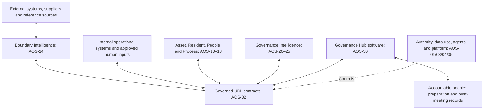

# AOS-00 — System Architecture and Specification Conventions

Document: aos-00 · Source revision or record: v0.55

AOS Specifications v1.0 · Edition dated 3 November 2026

Original architecture and specifications: Mark Sweeny, Governance Intelligence. © 2026 Mark Sweeny.

AOS-authored material is licensed under Creative Commons Attribution 4.0 International (CC BY 4.0). https://creativecommons.org/licenses/by/4.0/

Preserve third-party credits. Referenced external works remain subject to their own terms.

Canonical collection: https://www.governanceintelligence.co.uk/aos

Publication copy with editorial notices, public references and disclosure edits where applicable.

**DEC-105 adopted — 29 October 2026:** Current revision 0.55. Operational technical-control reliance requires declared scope/limits and accepted observed enforcement/failure/recovery evidence; build/prototype and G4/live approval gates remain separate. [Decision/amendment record](../Supporting-Specifications/aos-dec-105-technical-control-limits-and-evidence-2026-10-29.md). Earlier counts/baselines are dated history; current inventory and annex addendum control catalogue navigation. Existing non-waivable rules and DEC-099–104 retained; all new cases/variants remain planned/unexecuted.

**DEC-104 adopted — 29 October 2026:** Current revision 0.54. Each mandatory protected-finding category requires assessed technical-failure and implicated-person interference arrangements with an appropriately independent authorised alternative and no implicated sole release gatekeeper. [Decision/amendment record](../Supporting-Specifications/aos-dec-104-protected-reporting-and-implicated-recipients-2026-10-29.md). External reporting is conditional on justified lawful authority, not a default. Exact profiles/permissions, protected_finding v0.3 compatibility and actual evidence remain gates; amended wording retains ordinary separate review and cases are planned/unexecuted. Earlier contrary or narrower baselines are history for this scope.

**DEC-103 adopted — 29 October 2026:** Current revision 0.53. Decision validity/effective time, attributable evidence/authentication, minutes approval and permission to execute are separate. DEC-087 is partly superseded; [decision/amendment and legal-source record](../Supporting-Specifications/aos-dec-103-decision-validity-evidence-and-minutes-2026-10-29.md). No universal later-minutes or second decision-record approval gate. Exact instruments/evidence policy, KX-06 v0.3 compatibility and ordinary separate review/readiness gates remain required; cases unexecuted. Earlier contrary wording is historical only where explicitly identified.

**DEC-102 adopted — 29 October 2026:** Mark approved demonstrated adequacy of organisation-defined classifications/settings against governing constraints. Current document revision 0.52; see the [decision and amendment record](../Supporting-Specifications/aos-dec-102-classification-and-configuration-adequacy-2026-10-29.md). Earlier baselines are dated history. DEC-099–101 retained; detailed amended requirements remain subject to separate review/readiness gates and cases remain planned/unexecuted.

**DEC-101 adopted — 29 October 2026:** Mark approved demonstrated human capacity and meaningful review as conditions of operational reliance. Current document revision 0.51; [decision and amendment record](../Supporting-Specifications/aos-dec-101-human-capacity-and-meaningful-review-2026-10-29.md). Earlier dated baselines remain history. DEC-099/100 are retained; requirements remain amended proposed wording and cases planned/unexecuted, with separate review/readiness gates unchanged.

**DEC-100 adopted — 29 October 2026:** Mark approved separate advance-authorised minimum control-metadata access. Current document revision 0.50; this notice supersedes earlier baseline notices for the affected scope only. See the [decision and amendment record](../Supporting-Specifications/aos-dec-100-control-metadata-access-2026-10-29.md). DEC-099 remains approved. Requirements remain proposed wording implementing the approved direction; cases remain planned/unexecuted and ordinary separate review/readiness gates apply.

**DEC-099 adopted — 29 October 2026:** Mark approved the derived-information restriction rule. Current document revision 0.49; earlier functional/editorial baselines below are retained history. The [decision and controlled amendment record](../Supporting-Specifications/aos-dec-099-derived-information-restrictions-2026-10-29.md) governs this change. Existing requirement/case/IF identities are retained; amended wording remains subject to the normal separate review and readiness gates. No case execution or operating approval is implied.

**Editorial edition — 29 October 2026:** Mark authorised documentary corrections D-01–09. This edition reconciles navigation, count/revision pointers, conformance links and historical scope labels; existing technical meanings, requirement/IF/decision identities and proposed/planned status are retained. The internal version below identifies the retained functional baseline; this dated editorial edition identifies the corrected document. See the [current document inventory](../Supporting-Specifications/aos-current-document-inventory-2026-10-29.md) and [correction record](../Supporting-Specifications/aos-documentary-corrections-2026-10-29.md). Earlier dated adoption baselines are historical snapshots; exact logical family/view revisions are in Exchange Register §4.

Current documents: [Change Constitution draft](../Supporting-Specifications/aos-change-constitution-v0-1.md); Phase 2 Living Specification (deferred under DEC-098).

**Current supplier briefing —9October2026:** [Where does your product fit in AOS?](../Supporting-Specifications/aos-supplier-alignment-briefing-v0-1.md) is the plain-English supplier-facing draft under item12a. Explains possible product contributions, records/exchanges, retained responsibilities, permissions, failures, evidence and gaps; includes housing/asset/HR/sensor/finance/workflow/governance/platform examples, a repair illustration and short response template. Item12a author drafting complete; Mark review/publication remain separate. The earlier supplier outline now points to this briefing. AOS-00/Mapv0.47 records allocation only; DEC001–097, component/common meanings, source statuses and Phase2 deferral unchanged. Earlier dated next-task notices are history.

**Current item12 drafting —9October2026:** [Extension, architectural fit and scoped conformance](aos-extension-and-conformance-specification-v0-1.md) drafted at Mark’s request, with “Where does my product fit?” as the primary supplier objective. Defines product-to-function mapping, retained owners, information/contracts, capabilities/dependencies/gaps and bounded evidence-supported claims;20 proposed obligations/10 planned assessments and a repairs-platform example. Functional author drafting complete; exact wording review remains5d; supplier briefing12a next. No published API, supplier assessment, certification, execution, build or operating approval claimed. AOS-00/Mapv0.46; DEC001–097 unchanged; Sharedv0.21/Corev0.6/Registerv0.20/Matrixv0.21; component/acceptance/Phase2 baselines unchanged. Earlier dated next-task statements are history.

**Current functional-document completion — 9 October 2026:** Items6,8 and9 are complete for functional drafting, planned case allocation and author consistency review. See [final completion review](../Supporting-Specifications/aos-core-documentation-completion-review-v0-1.md). This is documentary completion, not whole-document approval, executed acceptance, G3/G4 or operating/institutional assurance. CAP-01/02 remain parked in Phase2; pilot5b and prior author correction closures remain closed. Mark review and implementation-specific contracts/run scope/verification are separate work. Items12/12a/13a/13/14 remain outstanding; the complete documentation/publication programme is not finished. Earlier dated task/baseline statements are history. AOS-00/Mapv0.45; DEC001–097 unchanged; Sharedv0.21/Corev0.6/Registerv0.20/Matrixv0.21; component and acceptance/Phase2 revisions unchanged.

**Current revision set:** AOS-00/Map v0.44; DEC-001–097; AOS-10v0.5/20v0.6/22v0.5/24v0.4/25v0.3/40v0.8; other components unchanged; Sharedv0.20/Corev0.6/Registerv0.19/Matrixv0.20; acceptance annexv0.2; reviewv0.3.

**Current scope decision — 9 October 2026, DEC-097:** Mark has moved CAP-01 Trade-Off Divergence and CAP-02 Risk Register Assessment into Phase 2 as specific use cases built on AOS. They are outside the current architecture/specification completion scope and are not current build, acceptance or publication prerequisites. No use-case design, configuration, implementation or testing is scheduled now. DEC-017's architectural inclusion is superseded on this point; its original record remains history. General human judgement, evidence, data-use/authority, independent challenge and protected reporting controls remain in the architecture. Dedicated legacy use-case IDs are retained only as deferred trace references, with original wording parked in Phase 2 (deferred under DEC-097); mixed rows retain only their general architectural obligations in current scope. Earlier inclusion/next-task/annex-dependency statements are superseded.

**Current acceptance corrections — 9 October 2026:** AT-CR-01–05 closed at functional-document/author-review level. AOS-40 v0.7 retains40 proposed requirements and38 planned parent cases, with108 individually assessable variants in the controlled acceptance annex. All variants remain planned/unexecuted. Architecture/Mapv0.43; Sharedv0.19/Corev0.6/Registerv0.18/SourceMatrixv0.19; DEC001–096 unchanged. Original parent acceptance and local component obligations remain necessary. Exact approved current-core execution scope/endpoints/profiles, human appointments, implementation evidence and independent/institutional assurance remain separate dependencies. Pilot5b remains closed. Earlier dated baseline/progress notices below are history; this correction and the linked controlled annex govern current acceptance planning.

**Current sensing consistency closure — 9 October 2026:** Mark authorised the remaining consistency work. SENS-CR-01–05 are closed at the functional-document/author-review level: all40 logical CON views across10–14 and40 have exact central adoption, producer/consumer/shared-owner and REQ/VER links; all80 controlled FP/RP/GT sources have precise current contributions and owned residual/gate dispositions; current body/control statements are reconciled. Versions10v0.4/11v0.3/12v0.3/13v0.2/14v0.8/40v0.6; Architecture/Mapv0.42; Sharedv0.18/Corev0.6/ExchangeRegisterv0.17/SourceMatrixv0.18; reviewv0.4. DEC001–096 unchanged. Sensing269 proposed REQs/176 planned VERs;40 retains40/38. No new requirement/case/interface, source promotion or execution. Exact compatible wire schemas/profiles, organisation appointments/capacity, independent review, legal/institutional/practice evidence and scoped build/activation remain separate; independent project review remains deferred. Earlier dated notices/addenda are historical. Current controlling allocation is the9October manifest and source addendum below.

**Current approved Boundary directions — 9 October 2026:** Mark agreed all five review recommendations at09:51UK time, qualifying material obligations to distinguish financial exposure from resource impacts. AOS-00-DEC-092–096 records those architectural directions; prior DEC001–091 unchanged. AOS-14 v0.7 incorporates the decisions into existing requirements/cases/contracts and resolves ISS003–007 at architectural-direction level. Exact organisation-specific materiality criteria, outcome evidence, obligation schemas/owners, declared control paths and pattern profiles remain implementation/commissioning gates; federation remains deferred. Architecture/Mapv0.41; Sharedv0.17/ExchangeRegisterv0.16/SourceMatrixv0.17; reviewv0.3. Other component versions unchanged.55 proposed Boundary requirements/34 planned cases; no new REQ/VER/IF, executed test, whole-document or build/operating approval. Earlier dated notices are historical. Next: remaining whole-sensing common/source/status corrections SENS-CR-02–04; independent review remains deferred as previously agreed.

**Current Boundary completion — 9 October 2026:** AOS-14 v0.6 completes the functional proposed core/research/supplier migration:55 requirements/34 planned cases, all80 FP/RP/GT contribution rows and explicit typed determination/contract mapping. Architecture/Map v0.40; DEC-001–091 unchanged. Shared Contracts v0.16/Exchange Register v0.15/Source Matrix v0.16 adopt Boundary-only links; Core v0.6, kernel01–05 v0.8 and10 v0.3/11 v0.2/12 v0.2/13 v0.1/25 v0.2/30 v0.5/40 v0.5 unchanged. Working naming resolved under existing OQ-013; federation deferred OQ-012; other material Boundary questions/commissioning and independent review remain gates. No new DEC/IF, case execution, build readiness or activation approval. Earlier dated baseline/next-step notes are history; no historical source status promoted. Next: Mark's Boundary review and scoped decision dispositions; complete remaining whole-sensing common/source/status remedies from SENS-CR-02–04.

**AOS-14 supplier perspective — 8 October 2026:** AOS-14 v0.5 now explains supplier integration/gateway/data/research/communication/sensor contributions, combined/manual/integrated arrangements, authoritative control and record ownership, worked contractor exchange and exact response rows. Proposed REQ-009/planned VER-007 cover supplier allocation; numbered totals are nine REQs/seven cases for research/supplier adoption only, with older Boundary criteria and full migration/source allocation still separate. Existing issues/decisions/common/source standings retained; no cases executed. Architecture/Map v0.39;10 v0.3,11 v0.2,12 v0.2,13 v0.1,40 v0.5 unchanged. Supplier consideration is included in all five domain drafts. Next is author five-domain/common consistency and source-allocation review; Mark review, item9 adoption, item8 annex/execution coverage, pilot5b and item6 remain open. Independent project review remains deferred; no build or operating approval. Earlier dated next steps are historical.

**AOS-13 functional drafting — 8 October 2026:** At Mark's request drafted AOS-13 v0.1 (historical revision; [document in this edition](../Sensing-Domains/aos-13-process-intelligence-and-operational-coordination.md)): 57 proposed requirements, 40 planned cases, eight logical common-contract views and all 29 GT contributions. Versioned definitions, bounded monitoring, shared current checks/accounting, staged acknowledgements and accepted human duty, partial effects/retries, actual service outcomes, recovery, domain integration, own research and supplier participation are allocated. Architecture/Map v0.38; AOS-10 v0.3,11 v0.2,12 v0.2 add reciprocal Process references only; AOS-40 v0.5 adds planned VER-038 and exact Process counterparts (38 planned cases, none executed). Existing decisions, source manifest and common baselines remain unchanged. All five initial domain drafts now exist; AOS-14 supplier consideration and author domain/common consistency/source-allocation review are next. Item 9 review/operating adoption, item 8 annex coverage/execution, pilot 5b and item 6 implementation/commissioning remain open. Independent project review remains deferred; author document checks do not establish G3/G4, build readiness or operating approval. Earlier dated progress notices are historical.

**AOS-12 functional drafting — 8 October 2026:** At Mark's request drafted AOS-12 v0.1 (historical revision; [document in this edition](../Sensing-Domains/aos-12-people-intelligence.md)): 53 proposed requirements, 35 planned cases, seven logical common-contract views and all29 GT applicability. Role-appropriate professional support, substantive human employment judgement, capability/development/AI literacy and manual competence, Employee Listening Charter, workforce privacy/small-group disclosure, workload/transition/unequal effects, worker rights/protected concerns, lifecycle/recovery and own external research are allocated. Supplier participation includes multi-function mapping, worked example and requirement-level response matrix. AOS-40 v0.4 adds People counterparts and planned VER-037 for human personnel judgement, small-group disclosure and professional capability continuity; now37 planned cases/40 proposed assurance requirements, none executed. Author structural/trace checks only; no independent assessment, legal conformance, G3/G4 or operating approval. Architecture/Map v0.37; DEC-001–091,10 v0.2,11 v0.1 and common/source baselines unchanged. Next: Mark's functional review, then AOS-13 Process with standing supplier consideration and exact domain/human accepted-duty adoption;14 supplier consideration due next revision. Item9/8 coverage/execution,pilot5b/item6 remain open; independent project review deferred.

**AOS-11 functional drafting — 8 October 2026:** At Mark's request drafted AOS-11 v0.1 (historical revision; [document in this edition](../Sensing-Domains/aos-11-resident-intelligence.md)): 55 proposed requirements,33 planned cases,seven logical common-contract views and full29-test GT applicability. Private resident-initiated assistance/selected sharing, accessible language/human alternatives, agreed-channel repair owner/team delivery, requests/complaints/participation, separately governed enterprise analysis, optional property-triggered tiers/human welfare, secure lifecycle/recovery and own external adaptation research are allocated. Supplier participation includes multi-function realisation, worked example and exact requirement-response matrix. AOS-40 v0.3 adds precise Resident counterparts to existing VER-007–010 and privacy/service cases; its36 planned cases/40 proposed REQs are unchanged. Author document checks only; no execution, independent assessment, legal conformance or G3/G4/operating approval. Architecture/Map v0.36; DEC-001–091,10 v0.2 and common/source baselines unchanged. Next: Mark's functional review, then AOS-12 People with the standing supplier consideration;13 Process follows and14 consideration remains due next revision. Item9/8 further coverage/execution,pilot5b/item6 remain open; independent project review deferred.

**Supplier participation redraft — 8 October 2026:** Mark requested explicit supplier technology/software fit in each sensing specification. AOS-10 v0.2 now explains multi-function supplier realisation, standalone/integrated arrangements, logical contracts versus executable interfaces, a bounded Aico/HomeLINK illustration and requirement-level supplier responses; 49 proposed REQs / 34 planned VERs. All original asset IDs retained. Apply the standing consideration to initial AOS-11/12/13 drafts and the next AOS-14 revision; item12a draws on these mappings. Architecture/Map v0.35 records the direction; no product selected, conformance certified, test executed or operating authority changed. DEC-001–091 and common/source/AOS-40 v0.2 baselines unchanged.

**AOS-10 functional drafting — 8 October 2026:** At Mark's request drafted AOS-10 v0.1 (historical revision; [document in this edition](../Sensing-Domains/aos-10-asset-intelligence.md)): 48 proposed requirements, 33 planned verification cases, seven logical common-contract views and full29-test GT applicability. Physical inspection/telemetry provenance, Living Asset Register coverage, uncertain condition/predictions, physical risk, resident-promise/completion evidence, investment inputs, building-safety information, manual fallback, privacy/recovery and own DEC-086 research are allocated. AOS-40 v0.2 adds asset counterparts and VER-036 building-information integration; its unknown-completion wording is corrected to DEC-039 rather than asserting definite incompletion from missing evidence. Author structure/reciprocal trace checks only; no case execution, independent assessment or G3/G4/operating approval. Architecture/Map v0.34; DEC-001–091 and common/source baselines unchanged. No new general design decision is needed to complete this draft; exact organisation/build/profile/endpoint dependencies remain owned. Next: Mark's functional review, then AOS-11 Resident Intelligence alongside AOS-13 Process repair/contact/duty integration. Item9 remains open for remaining domains; item8 execution/annex coverage, pilot5b and item6 remain open; independent project review deferred.

**AOS-40 functional drafting — 8 October 2026:** At Mark's request drafted AOS-40 v0.1 (historical revision; [document in this edition](../Supporting-Specifications/aos-40-acceptance-integration-assurance-and-commissioning.md)): 40 proposed requirements, 35 planned system verification cases, full 29-test GT applicability, bounded overdue-repair contrasts, governance/authority/privacy/protected-reporting/recovery/integration/provider/drift/human-review/commissioning cases and own DEC-086 research profile. Author structural and reciprocal REQ–VER checks passed; no scenario execution, independent assessment, G3/G4 or operating approval. AOS-00/Map v0.33 document allocation only; DEC-001–091 and existing component/common-contract/source statuses unchanged. Domain/annex-specific cases, exact executable profiles/compatibility and observed evidence remain owned dependencies. Earlier dated starting points are historical. Next: Mark's functional review of AOS-40, then item 9 domain specifications, starting with AOS-10 Asset Intelligence in coordination with Resident/Process boundaries. Independent project review remains deferred; pilot 5b remains open.

**GI consistency closure — 7 October 2026:** Mark authorised GI-CR-01–04 corrections and closure. Functional drafting, reciprocal report-independence wording, decision/outcome consumer allocation, Mode 2 wording and current completion statements are reconciled. AOS-23 changes counterpart/current references only; its REQ/VER/CON rows are unchanged. AOS-00/Map v0.32, DEC-001–091; AOS-20 v0.5/21 v0.6/22 v0.4/23 v0.5/24 v0.3/25 v0.2/30 v0.5; AOS-01–05 v0.8, AOS-14 v0.4; Shared v0.15/Core v0.6/Exchange Register v0.14/source matrix v0.15; template v0.4; Control Coordination v0.2/Protected Reporting and Recovery v0.1. The review v0.2 records closure evidence; next AOS-40 acceptance scenarios. Earlier dated baseline/next-step statements remain historical. No new DEC/IF/operating power, case execution or build/activation/readiness approval; independent project review remains deferred and operating human independence remains mandatory.

**Current AOS-25 allocation — 7 October 2026:** AOS-25 v0.1 drafted at Mark’s request: purpose/precedent and Mode 1/2 drift, overrides, developer-framework divergence, cumulative/system effects, coverage and distributional patterns; unranked CAP-01 longitudinal evidence; GI account alongside independently prepared annual/material-triggered human review; empowered disposition, accepted corrective owners/dates and actual consequence learning; protected handoff, corrections including affected 30 workflows, own DEC-086 research and GI research-portfolio oversight. 48 proposed REQs, nine CON views, 30 planned cases and four unsubstantiated CRs; none executed. No new DEC/IF or automatic calibration/deployment/schedule. Mapped GI component drafting is complete; wording, whole-set consistency/disposition review and operating dependencies remain. Next: author GI-set consistency/disposition review across AOS-20–25 and AOS-30, then AOS-40 acceptance scenarios under item 8; independent project review remains deferred. AOS-00/Map v0.31, DEC-001–091; AOS-25 v0.1; AOS-20 v0.4/AOS-21 v0.5/AOS-22 v0.3/AOS-23 v0.4/AOS-24 v0.2/AOS-30 v0.4 (counterpart-reference alignment only); AOS-01–05 v0.8, AOS-14 v0.4; Shared v0.14/Core v0.6/Exchange Register v0.13; source matrix v0.14; template v0.4; Control Coordination v0.2/Protected Reporting and Recovery v0.1. No build/activation/readiness approval. Earlier dated baseline/next-step entries remain history.

**Current AOS-24 allocation — 7 October 2026:** AOS-24 v0.1 drafted at Mark’s request: faithful canonical rendering and provenance; uncertainty/review and exact Chair/board/action standing; unranked CAP-01 divergence and distinct assessment dimensions; accessible Petra interaction, scoped confirmation and challenge; purpose-bound audience disclosure; independent/protected preparation, correction notifications including affected AOS-30 workflows, evidenced delivery and own DEC-086 research. 40 proposed REQs, eight CON views and 26 planned cases, none executed. No new DEC/IF, deployment, schedule or numerical default. Next AOS-25 oversight, drift and learning; wording review and operating dependencies remain. AOS-00/Map v0.30, DEC-001–091; AOS-24 v0.1; AOS-21 v0.4/AOS-22 v0.2/AOS-23 v0.3 (reference alignment only); AOS-01–05 v0.8, AOS-14 v0.4, AOS-20 v0.3, AOS-30 v0.3; Shared v0.13/Core v0.6/Exchange Register v0.12; source matrix v0.13; template v0.4; Control Coordination v0.2/Protected Reporting and Recovery v0.1. No build/activation/readiness approval. Earlier dated baseline and next-step entries remain history.

**Current AOS-22 allocation — 7 October 2026:** AOS-22 v0.1 drafted at Mark’s request: permitted cross-domain synthesis; evidence-grounded proposed interpretation; human constitutional/value referral; actual-state options including infeasible alternatives; CAP-01 rigour/shared-basis divergence without ranking or recommendation between readings; independently governed preparation; canonical review, protected handoff, correction/outcome feedback and own DEC-086 research. 52 proposed REQs, nine CON views and 32 planned cases, none executed. No new DEC/IF or inferred moral-weight/default. Next AOS-24, then AOS-25; wording review and operating dependencies remain. AOS-00/Map v0.29, DEC-001–091; AOS-22 v0.1; AOS-21 v0.3/AOS-23 v0.2 (counterpart/reference alignment only); AOS-01–05 v0.8, AOS-14 v0.4, AOS-20 v0.3, AOS-30 v0.3; Shared v0.12/Core v0.6/Exchange Register v0.11; source matrix v0.12; template v0.4; Control Coordination v0.2/Protected Reporting and Recovery v0.1. No build/activation/readiness approval. Earlier dated baseline entries remain history.

**Current AOS-23 allocation — 7 October 2026:** AOS-23 v0.1 drafted at Mark’s request: permitted ingestion/normalisation; scoped criteria/application; document quality, claim support and practice evidence assessed separately under DEC-091; evidence/uncertainty and graduated human review; artefact/source currency monitoring, owned/protected alerts, reporting-cycle inputs, corrections/outcome feedback and own DEC-086 research remit. 52 proposed REQs, nine CON views and 32 planned cases, none executed. No new DEC/IF or numerical default. Next AOS-22 synthesis/interpretation/options, followed by AOS-24/25; wording review and operating dependencies remain. AOS-00/Map v0.28, DEC-001–091; AOS-23 v0.1; AOS-21 v0.2 (functional endpoint/reference alignment only); AOS-01–05 v0.8, AOS-14 v0.4, AOS-20 v0.3, AOS-30 v0.3; Shared v0.11/Core v0.6/Exchange Register v0.10; source matrix v0.11; template v0.4; Control Coordination v0.2/Protected Reporting and Recovery v0.1. No build/activation/readiness approval. Earlier dated baseline entries remain history.

**Current AOS-21 allocation — 7 October 2026:** AOS-21 v0.1 drafted at Mark’s request: scoped organisation/subsidiary profiles; external/operational/constitutional corpus; sourced artefact catalogue and criteria; delegated human stewardship; explicit approved precedent; currency, coverage, material correction and independent review; own DEC-086 research remit. 48 proposed REQs, eight CON views and 30 planned cases, none executed. DEC-090/091 applied; no new DEC or IF. Next AOS-23 using permitted corroboration with documentary quality, claim support and practice evidence separate. Functional drafting complete; wording/whole-document review and implementation/commissioning dependencies remain. AOS-00/Map v0.27, DEC-001–091; AOS-21 v0.1; AOS-01–05 v0.8, AOS-14 v0.4, AOS-20 v0.3, AOS-30 v0.3; Shared v0.10/Core v0.6/Exchange Register v0.9; source matrix v0.10; template v0.4; Control Coordination v0.2/Protected Reporting and Recovery v0.1. No build/activation/readiness approval. Earlier dated baseline notes remain history.

**Current GIL scope disposition — 7 October 2026:** Q01/Q02 approved by Mark as DEC-090/091; AOS-00/Map v0.26, DEC-001–091. Subsidiary profiles and permitted corroboration are settled for AOS-21/23 drafting. See approved disposition at the end. Earlier dated baseline notes remain history.

**Current AOS-30 alignment — 7 October 2026:** functional drafting and consistency alignment complete under Mark’s instruction. AOS-00/Map v0.25, DEC-001–089; AOS-01–05 v0.8, AOS-14 v0.4, AOS-20 v0.3 and AOS-30 v0.3; Shared v0.9/Core v0.6/Exchange Register v0.8; source matrix v0.9 and template v0.4 unchanged; Control Coordination v0.2/Protected Reporting and Recovery v0.1 unchanged. Earlier dated baseline/adoption/next-step entries are history. CR30-01–03 are closed at the functional-document level; implementation/commissioning evidence remains separate. No new DEC/REQ/VER/IF identifier or operating power is introduced.

**Current AOS-30 disposition:** DEC-087–089 approved 6 October; AOS-30 v0.2 incorporates Mark’s Q01 role/approval qualification and agreed Q02/Q03. See the approved-direction disposition at the end; earlier pending-choice notes are dated history.

| Document control | Value |
|---|---|
| Version / date | 0.55 / 29 October 2026 |
| Status | First draft for project review; not ready for authorised build |
| Project owner | Mark Sweeny |
| Author | Codex, at the project owner's request |
| Architecture owner / independent reviewer | Not yet assigned / not yet assigned |
| Approver / approval record | Project owner for the specification baseline; commissioning authorities for their instruments / project direction decisions approved on 19/28 September and 3/4 October 2026 as recorded per decision; whole-document approval absent |
| Quality standard | AOS-QS v0.1, itself a draft |
| Scope | Shared logical architecture and specification conventions for the 19-document suite |
| Source baseline | Supplied project documents listed in §2; dated inventory in the companion source manifest |
| Deployment / release | Reusable core, illustrative worked example; complete AOS specification scope; one overdue-repair workflow for proof of concept; production release unselected |
| Gate | G1 author self-assessment only; G2–G4 not claimed |
| Change history |0.42 — author sensing consistency/source/common closure; no new DEC/REQ/VER/IF;  0.41 — Mark approved five Boundary principles as DEC092–096; component adoption and financial/resource qualification; 0.40 — full Boundary functional/source/common migration;  0.39 — Boundary supplier perspective, proposed component allocation requirement and planned case; no new DEC or parent REQ/VER.  0.38 — Process functional/domain/control acceptance allocation; no new DEC or parent REQ/VER.  0.37 — People functional/acceptance allocation; no new DEC or parent REQ/VER.  0.33 — AOS-40 v0.1 functional case/assurance allocation; no new DEC or parent REQ/VER. 0.32 — GI-CR-01–04 author consistency correction/closure under Mark’s instruction; existing identifiers and proposed/planned status preserved. 0.31 — AOS-25 oversight/drift/learning allocation; GI/30 counterpart references only; no new DEC or parent REQ/VER. 0.30 — AOS-24 functional allocation; 21–23 reference alignment only; no new DEC or parent REQ/VER. 0.29 — AOS-22 v0.1 allocation/shared adoption; AOS-21/23 counterpart reference alignment only; no new DEC or parent REQ/VER.  0.28 — AOS-23 v0.1 functional allocation and existing shared adoption; AOS-21 v0.2 reference alignment only; no new DEC or parent REQ/VER.  0.27 — initial AOS-21 v0.1 allocation and common functional adoption; no new DEC or parent requirement/case change.  0.26 — records Mark’s 7 October approval of GIL comparison Q01/Q02 as DEC-090/091; aligns Map v0.26; component drafting remains next.  0.1 — initial draft. 0.2 — records project-owner decisions of 19 September 2026 on scope, source hierarchy, component boundaries, delegated authority, human records, independent review, deployment and data-location assessment. Decision dispositions are in §10; corresponding architecture text is updated in §§1–3/5–6/10–12. 0.3 — reconciles the 22 proposed requirement statements and their planned verification links with DEC-001–020; see §4.1. The original v0.1 source manifest remains unchanged. 0.4 — splits combined requirements, allocates outstanding decisions as REQ-023–040, assigns component detail and adds planned VER-013–018. 0.5 — records the 28 September project-owner directions on a single overdue-repair proof of concept, organisation-specific consequential-action boundary, board-only telos amendments and protected delegation changes; adds REQ-041–049 and VER-019–022. 0.6 — aligns the map reference and cross-document discrepancy record with SPECIFICATION_MAP v0.3; no new design direction. Proposed normative wording remains subject to baseline approval. 0.7 — records Mark’s 4 October approval of DEC-002 shared-contract ownership; incorporates the already confirmed 3 October semantic-explanation default as DEC-027 from FAR-R-002; aligns Map v0.4 references. REQ-001–049 and VER-001–022 wording/status remain unchanged; no whole-document or build approval. 0.8 — records Mark’s 4 October approval of Q01–03 as DEC-028–030, aligns Map v0.5 and preserves proposed requirement/planned verification status. 0.9 — records Mark’s 5 October approval of five operational-profile directions as DEC-031–035; aligns Map v0.6. Exact profile wording/values and component REQ/VER allocation remain open. 0.10 — records approved date/evidence directions and resident-agreed channels as DEC-036–041; aligns Map v0.7. Requirement wording and operational settings remain open. 0.11 — records Mark’s approval of agent delegation, withdrawal and conflict directions DEC-042–044; aligns Map v0.8 and AOS-01 v0.2. No requirement or readiness status promoted. 0.12 — records approved common-data directions DEC-045–048, including fact-assurance provenance and HACT preferred-reference status; aligns Map v0.9/AOS-02 v0.2. Exact requirements remain proposed. 0.13 — records approved AOS-03 directions DEC-049–053; aligns Map v0.11 / AOS-03 v0.2 without promoting readiness. 0.14 — records approved AOS-04 directions DEC-054–057; aligns Map v0.13/AOS-04 v0.2. Parent REQ/VER statuses remain unchanged. 0.15 — records Mark’s AOS-05 approvals DEC-058–061; aligns Map v0.15/AOS-05 v0.2 without promoting readiness.  0.16 — records Mark’s 6 October approval of action-2 directions DEC-062–066; common exchange register v0.1 and component v0.4 adoption; aligns Map v0.16. Normative wording remains proposed and verification planned.  0.17 — records six action-3 approvals DEC-067–072, including withholding notification; Map v0.17, control-coordination annex v0.1, kernel component v0.5 and common register v0.2 adoption; no requirement/readiness promotion. 0.18 — DEC-073–078 all-six action-4 approval, standards provenance and reciprocal reporting/recovery adoption. 0.19 — DEC-079–085 seven GI design approvals, including agentic research for adaptation of the GI function under amended Q04; AOS-20 drafting next, no agent deployment or requirement promotion. 0.20 — initial AOS-20 charter draft under DEC-079–085; no new decision or parent REQ/VER promotion; Map/common allocation/source traceability aligned. 0.21 — DEC-086 distributed component external research, AOS-01/02/04 v0.7 and template v0.4; five proposed architecture REQs/three planned VERs; downstream adoption visible. |

## 1. Purpose and scope

AOS-00 establishes the common architecture from which the component specifications will be derived. Its intended outcome is a coherent suite that an AI coding agent can implement without inventing material architectural or governance decisions. It defines responsibility boundaries, information paths, human authority boundaries, shared vocabulary and the conventions used to make the suite reviewable.

The AOS is a socio-technical operating system: software, data, governance instruments and human practice together. This specification concerns the software architecture and its explicit dependencies on those other elements. It does not specify a board into existence or treat institutional judgement as a software capability.

The agreed design target is a reusable AOS core for housing organisations, with a worked example. The specification suite covers the complete AOS; implementation may proceed in stages. Organisation-specific roles, policies and thresholds are example configuration, not universal defaults or live organisational authority. The project owner confirmed this direction on 19 September 2026. On 28 September the project owner selected one overdue-repair workflow as sufficient proof-of-concept scope. D01 is resolved for specification scope and the proof-of-concept demonstration; actual deployment, integrations, users and production release remain to be determined.

The initial jurisdiction for the specifications and its worked example is **England**, confirmed by the project owner on 19 September 2026 (DEC-016). Jurisdiction-specific legal and regulatory requirements must remain distinguishable from reusable architectural and governance constraints. This is a scope decision, not a verified legal mapping or a claim of suitability for other jurisdictions. Applicable obligations and authoritative sources remain to be verified under D11.

The whole-suite architectural scope includes the five sensing intelligences, Governance Intelligence, the Unified Data Layer, shared controls and software supporting the Governance Hub. A staged release requires approved scope and dependency effects. Under DEC-097, CAP-01 Trade-Off Divergence and CAP-02 Risk Register Assessment are specific Phase 2 use cases built on this architecture, outside current architectural completion. Their former DEC-017 inclusion is superseded; no use-case specification or implementation priority is selected now. This draft selects no vendor, model, cloud, database, deployment topology, service target or autonomy threshold.

### Core constraints and organisational configuration

On 19 September 2026, the project owner confirmed that every implementation of the reusable core must preserve the foundational AOS constraints, including permanent human Mode 2 and boardroom exclusion. On 28 September the project owner expressly included protected amendment of the organisation's telos and Schedule of Delegated Authorities. The other non-waivable constraints in this draft include purpose limits, authority checks and reconstructable records. Organisations define the operational boundary of consequential action and configure roles, workflows and thresholds within these constraints. Configuration cannot waive governing FP/RP constraints or bypass the protected amendment processes. Specific classification criteria, fields, permitted ranges and validation rules belong in the responsible specifications and each organisation's approved instruments; this decision supplies no numerical defaults.

Stakeholders include residents seeking understandable and contestable decisions; the board holding conferred purpose; executives and staff accountable for action; governance and data stewards; operators maintaining service; suppliers exchanging information; reviewers and regulators examining evidence; and builders needing unambiguous contracts. Their access and authority are separate questions, to be determined by AOS-01/03 rather than inferred from this list.

## 2. Authority and sources

### 2.1 Working source baseline

Source IDs are local references, not new principle numbers. Exact supplied files and SHA-256 fingerprints are recorded in [the source manifest](aos-historical-source-summary.md). Fingerprints identify the draft's inputs, not their approval. The manifest must be updated deliberately when sources change.

| ID | Source and locator used in this draft | Standing |
|---|---|---|
| OBJ | `PROJECT_OBJECTIVE.md`, complete objective | User's project outcome |
| MAP | `SPECIFICATION_MAP.md` v0.1, §§1–9 and §11 | Proposed suite allocation and decision questions |
| QS | `SPECIFICATION_QUALITY_STANDARD.md` v0.1, QS-01–28 and Appendix A | Draft project writing/review rules |
| FP | `Foundational_Principles_v4.docx`, principles 1–10 by their printed headings | Foundational settlement |
| RP | `AOS_Reasoning_Principles_v6.docx`, numbered domains and individual principle opening phrases | Current supplied reasoning baseline; individual principles are not assigned invented source numbers |
| GT | `Governance_Intelligence_Tests.docx`, M1.1–M1.14 and M2.1–M2.15 | Governance assessment framework; not solely software tests |
| B4 | `Book 4.docx`, “Unified Data Layer”, “Cross-Domain Agentic Coordination”, “The Override Documentation Requirement” and domain/Hub chapters | Architecture and institutional intent |
| GI-WP | `Governance Intelligence- Internal Architecture - Working Paper.md`, “The five elements”, “Governance of drift” and “Validation regime” | Working proposal; references RP v5 and needs v6 reconciliation |
| BI-N | `Boundary Intelligence.md`, imported note, complete proposal | Responsibility demarcation resolved by DEC-005; detailed system-wide enforcement mechanisms remain proposals under AOS-01/05 |
| GIL | `GIL_Technical_Specification_V2.docx`, whole-document reuse scope as allocated by MAP §5 | Existing design input; not a universal technology baseline |

Books 1–3 supply wider philosophical and practice context, already reviewed in `BOOK_REVIEW_AND_OBJECTIVE_ALIGNMENT.md`. Requirements below use more specific FP/RP/GT/B4 anchors rather than treating that review as primary authority.

### 2.2 Reconciliation and normative status

The project owner approved the source hierarchy on 19 September 2026: FP v4 and RP v6 are the governing constraints; the four books explain intent and architecture within them; existing specifications and working notes supply proposals to reconcile against those constraints. This resolves D02 for the supplied baseline. Substantive conflicts are referred to the project owner for explicit resolution. Newer notes do not automatically override established principles. Later source revisions require a recorded baseline decision.

The explicit RP domain 2 boardroom exclusion governs this draft: no AI presence, observation or real-time capture of deliberation. Only a separately governed post-meeting human record enters the software. Details remain D04. The word “conscience” describes GI's constitutional role in the architecture; it grants the software no consciousness, moral standing or final adjudicative authority. FP principles 1–2 control that interpretation.

“Shall” in §4 identifies a **proposed requirement**, not an approved capability. Other sections explain the proposed design and allocate unfinished details. New engineering conventions are labelled E; source-derived requirements are labelled S. Neither label records approval. An unresolved value has no implied default.

### 2.3 Principle applicability at this level

All ten FP principles apply to the whole-system architecture. Requirements 001–019 below address purpose, permanent human Mode 2, structural controls, transparency, failure, uncertainty and feedback. Detailed resident/no-exit protocols remain in AOS-03/11/30; this is not a claim to have completed them.

All nine RP domains apply: Architecture and Completeness to requirements 001, 003, 010 and 012; the Mode 1 / Mode 2 Boundary to 005–008; the 1+5 Architecture to 001–003; Options and Decisions to the conflict walkthrough in §6 and verification case 003, with detailed option-set obligations still to be allocated to AOS-22; Blind Spots and Honesty to 014/019; Ethics and Telos to 005/015/018; Radical Transparency to 010/012/013; Agentic Delegation to 006/007/009/011; and Data and Sensing Boundaries to 004 and the AOS-03/10–12 allocations. Detailed principle-by-principle disposition remains review finding F02.

GT M1.2, M1.7, M1.8, M1.10, M1.11 and M1.13 inform architecture evidence and planned cases. GT M2.3, M2.4, M2.8, M2.9, M2.12, M2.13 and M2.15 inform boundaries and human review. The remaining tests require allocations in AOS-40 and the relevant domain specifications. No GT test is declared passed by this document.

## 3. Context and architecture

### 3.1 Logical responsibility catalogue

The project owner adopted these 19 specification boundaries as the working baseline on 19 September 2026, with later revision permitted if detailed drafting reveals gaps or overlap. They are specification ownership boundaries, not a requirement for 19 applications or independently deployed services.

| ID | Component / specification responsibility | Principal boundary |
|---|---|---|
| AOS-00 | Shared architecture and conventions | Owns system allocation, not component algorithms |
| AOS-01 | Authority, constitutional controls and change | Defines permission, prohibition, reserved decisions and activation policy |
| AOS-02 | Unified Data Layer and shared records | Owns common semantics, record contracts and governed exchange |
| AOS-03 | Identity, access, consent and data use | Enforces legitimate access and permitted processing purposes |
| AOS-04 | Common agent architecture and lifecycle | Defines agent execution contract and lifecycle |
| AOS-05 | Platform operation, security and resilience | Owns runtime controls, recovery and operational evidence |
| AOS-10 | Asset Intelligence | Physical asset condition and related evidence; no implicit resident behaviour inference |
| AOS-11 | Resident Intelligence | Resident assistance and participation; enterprise analysis requires separate permissions |
| AOS-12 | People Intelligence | Workforce support and authorised organisational signals; employment judgement remains human |
| AOS-13 | Process Intelligence and operational coordination | Executes bounded workflows, routes context and tracks exceptions |
| AOS-14 | Boundary Intelligence and external exchange | Controls inbound/outbound exchange and external commitments |
| AOS-20 | GI architecture and charter | Defines GI's authorising and obligating responsibilities |
| AOS-21 | Corpus, organisation knowledge and precedent | Curates authoritative evidence and controlled interpretations |
| AOS-22 | Synthesis, interpretation and option preparation | Connects evidence and prepares propositions for human judgement |
| AOS-23 | Governance artefact assessment and monitoring | Assesses artefacts and monitors currency against controlled criteria |
| AOS-24 | Petra, presentation and explanation | Renders analysis and reviewed positions without acquiring decision authority |
| AOS-25 | Governance oversight, drift and learning | Surfaces drift, blind spots and review evidence; cannot certify itself sufficient |
| AOS-30 | Governance Hub and accountable decision workflows | Software support for human preparation, handoffs and post-meeting records |
| AOS-40 | Acceptance, integration assurance and commissioning | Owns suite-level verification and commissioning evidence |

The five sensing domains are AOS-10–14. GI is AOS-20–25 as a whole, not a sixth sensing peer. The Governance Hub includes the actual board, committees and delegated human authorities; AOS-30 is only its software support. Risk is intrinsic to every domain, with cross-domain synthesis in GI. Technical coordination belongs in Process Intelligence; moral priority between incommensurable goods remains with authorised humans.

### 3.2 Information-flow view

Arrows show controlled information exchange, not unrestricted access or direct deployment connections. Boundary is the fifth sensing domain and appears separately to make external exchange visible. Shared controls apply at producers, consumers and execution points, not just at UDL storage. The diagram does not introduce an AI link into board deliberation.

The UDL is a governed logical substrate. It need not be one physical database or one event bus. Direct agent messages carrying domain evidence, instructions or decisions around its contracts are excluded. Internal function calls within a module remain an implementation choice, but cannot remove required records, permissions or cross-domain controls. Low-level infrastructure traffic is not a new domain evidence channel; its permitted content and segregation need definition in AOS-05.

### 3.3 Execution and trust boundaries

The proposed execution path is evidence admission → authorised analysis → action request → authority/data-use validation → bounded execution or human escalation → recorded outcome. A model-generated proposal is not an execution permission. The executor consumes an authority determination tied to the relevant action and context; token format, lifetime and enforcement design remain AOS-01/03/05 work.

Trust boundaries exist between external systems and AOS ingress; people and service identities; declared processing purposes; analysis and actuation; ordinary administration and constitutional change; and AI preparation and human deliberation. An internal source is still subject to provenance and data-use controls. An administrator's technical access does not imply governance authority.

On 19 September 2026, the project owner approved the following demarcation (AOS-00-DEC-005):

- **Governance Intelligence** interprets evidence against purpose and approved governance instruments, exposes conflicts, prepares options and identifies matters requiring human judgement.
- **Boundary Intelligence** governs exchanges across the organisation's external boundary: what enters or leaves, under what authority, for what purpose and with what obligations.
- **Shared enforcement controls**, specified in AOS-01/03/05 with the agent contract in AOS-04, apply approved permissions and prohibitions across every component, including GI and Boundary Intelligence. They belong to neither intelligence and create no additional intelligence domain.
- **Authorised humans** adjudicate Mode 2 questions and approve governance instruments and constitutional changes.

GI may identify a constitutional issue but cannot authorise its own resolution or bypass enforcement. Boundary Intelligence applies external-exchange controls without acquiring authority to interpret or amend the organisation's constitutional settlement. Its own actions are also subject to shared controls.

This adopts the responsibility distinction, not every mechanism in BI-N. The proposed control planes, independent enforcement and constitutional amendment mechanisms still require a threat model and explicit authority design under AOS-01/05. No claim of invulnerability, particular dual-key mechanism or operational approval follows from this decision.

### 3.4 Deployment view and assumptions

Logical deployment zones are user interaction, ingestion/integration, analysis, shared records, controlled execution, administration and assurance. These zones describe separation concerns only. Each housing organisation will operate a separate AOS instance as the initial design baseline, as approved on 19 September 2026 (DEC-014). Reuse applies to the software; organisational data, governance instruments and delegated authority remain separate. A platform serving several organisations within a shared application instance is outside this initial baseline and would require a later explicit scope decision. This does not yet select physical infrastructure or require a separate cloud provider/account for each organisation. Whether logical zones become separate processes, services or networks remains D10. Data residence, instance-isolation mechanisms, model access, secrets, backup and recovery are unselected. No diagram implies that every component shares a security identity or database privilege.

The project owner confirmed on 19 September 2026 that the initial AOS design integrates with existing housing, finance and HR systems rather than requiring their replacement (DEC-015). The UDL provides shared meaning and governed exchange. AOS-02, with the relevant domain and integration owners, must identify which system is authoritative for each record type and define reconciliation, correction and event publication before integration. “Unified” does not mean replacing every source system or treating a model's interpretation as authoritative data. Specific products, connector capabilities and migration arrangements remain organisation-specific decisions under D10/D11.

### Technology neutrality and data-location assessment

On 19 September 2026, the project owner confirmed that AOS-00 remains technology-neutral. Concrete hosting, database and software-framework choices belong in the platform specification and must be settled for the relevant build handover (DEC-019).

The platform specification must address the legal and regulatory frameworks applicable to where data is stored, processed, backed up and accessed, including AI-provider processing and overseas support access. Permitted locations are to be assessed against those requirements rather than subject to an assumed blanket UK-only rule at this stage. Eventual hosting and data-access arrangements require explicit approval (DEC-020). This does not pre-authorise any location, transfer or provider.

AOS-03/05/14 must document the actual data flows, processing and access locations, applicable frameworks, verified requirements, supporting evidence and approving authority, with the relevant professional owners under D11. This document records an assessment obligation, not a completed legal analysis. Location, supplier or access changes require assessment of their effect on the approved arrangements. Detailed assessment and change-control procedures remain to be specified.

### Model-provider replaceability

On 19 September 2026, the project owner confirmed that the reusable core must permit replacement of AI model providers without changing its governance rules or component interfaces (DEC-013). Provider-specific integration belongs behind those interfaces. This is an architectural requirement, not a claim that models are behaviourally equivalent or interchangeable without engineering work.

Each replacement requires evaluation and approval before activation. AOS-04/05/25/40 must specify compatibility, behaviour and governance-boundary evaluations, approval evidence, controlled activation and rollback. A provider change cannot silently alter delegated authority, permitted data use or the meaning of approved records. Provider selection, hosting, data handling, evaluation thresholds and approval roles remain open under D09/D10 and the relevant governance instruments.

### 3.5 External research for component adaptation

Under DEC-086 every specification responsibility has an assigned agentic external-research capability and controlled component profile. Distributed component ownership supplies specialist relevance/implication assessment; Boundary Intelligence governs external access, source verification and exchange and may share collection/distribution. Each component retains its distinct remit, findings, coverage and review accountability even when agents/infrastructure are shared. Boundary also researches changes to its own function. This is part of the existing architecture, not an additional sensing intelligence or permission to deploy nineteen agents.

| Responsibility | Authoritative specification |
| --- | --- |
| Assign research inheritance and component coverage | AOS-00 and Specification Map; mandatory template v0.4 |
| Common research-agent behaviour/profile semantics and bounded execution | AOS-04 v0.7 §§3.1/6.6; common controls 01/03/05 |
| Research remit, specialist interpretation and substantive implications | Each affected component and its accountable human owner |
| Govern external retrieval, source verification and permitted shared distribution | AOS-14; it owns its boundary-specific research remit, not every domain’s interpretation |
| Common research record structure/provenance/coverage/change links | AOS-02 v0.7 §6.6; substantive semantic owners remain distinct |
| Coordinate multi-component handoff and continuing duties | AOS-13 with each component/AOS-30; GI assesses governance implications where relevant |
| Approve review disposition, specification amendments and release | Empowered humans via AOS-30/01; actual activation through applicable shared controls |

Each component specifies a controlled research profile: exact component/specification baseline and remit; research questions and applicable jurisdictions; relevant legal/regulatory/standards/technical/research/practice/incident topics; preferred authoritative sources and source-admission criteria; cadence and event triggers; allowed retrieval tools and data-use/authority controls; assigned research agent or shared-service responsibility; coverage/currentness limits; relevance/materiality/urgency and evaluation rubric; accountable component reviewer, handoff owner, permitted recipients, response deadlines, cover and escalation; record/version/lifecycle rules and change route. Values and appointments require the applicable approval; absent mandatory values remain visible dependencies, with dependent research activation/reliance withheld. No numeric cadence, universal source list or always-on browsing default is supplied.

Approved component research profile and exact baseline → permitted external retrieval through AOS-14 → source/provenance/date/applicability evidence → component assessment of relevance and affected requirements/functions/contracts → finding or bounded no-material-finding/coverage-gap result → authorised recipient and accountable handoff → recorded human disposition → controlled change candidate if accepted → required approval, verification, compatible activation and outcome follow-up. Urgent operational/legal/safety implications use their separately authorised response route while specification change remains pending; a research finding supplies no emergency power. One retrieved source may feed several permitted component assessments; each preserves its own implications, review duties and disposition.

GI’s internal sensing of organisational patterns/purpose/precedent drift remains distinct from GI external research. Performance monitoring is also distinct from researching whether a component specification should adapt. Research cannot amend specifications, tune protected constraints, grant itself tools/powers or reopen deferred exploratory self-calibration under DEC-018. Credible urgent implications may require permitted human operational/legal/safety response before a specification amendment completes. Agents preserve legal/regulatory/standards publication/proposal/adoption/effective and jurisdiction distinctions; uncertain applicability receives competent human review rather than an AI legal verdict.

## 4. Proposed requirements

All IDs below have the prefix **AOS-00-REQ-**. They are system requirements except 020–022 and 041, which are specification design constraints. All forty-nine requirement records have status **proposed** and release **whole-suite logical baseline**; REQ-041–044 select a proof-of-concept demonstration, while production implementation scope remains unselected. REQ-001–022 originated in v0.1; v0.3 amended 006–008, 011–012, 015, 018 and 021. In v0.4, 007/008/015/018/021 recover their single original obligations while their additional duties are allocated to REQ-023–040. The project owner approved directions DEC-021–026 on 28 September; the exact normative text in REQ-041–049 remains proposed. Requirement stewardship rests with the architecture owner (unassigned); specialist ownership is allocated in the table. Approval requires project baseline approval and, for operational authority/data-use matters, the relevant commissioning authority under D03. Those authorities are not yet named. This shared metadata applies to every row and is not an approval shortcut.

Source column S means source-derived translation; E means a proposed engineering derivation. Verification references use AOS-00-VER- prefixes, defined in §9. Dependencies cite map decisions D01–D13 or draft decisions in §10; none are assumed resolved.

| ID | Proposed normative statement | Source / rationale | Allocated owner; dependencies | Verification |
|---|---|---|---|---|
| 001 | The suite shall allocate each software responsibility to the §3.1 catalogue with one authoritative specification owner. | S: MAP §§1,3–6; RP domain 3, “Every proposed governance mechanism…”; prevents misplaced functions. | 00; D02, DEC-00-01 | 001 |
| 002 | The AOS shall preserve GI's governance-support role separately from the five sensing domains. | S: RP domain 3, “Every proposed governance mechanism…”; preserves 1+5. | 20; D02 | 001 |
| 003 | Each sensing domain shall exchange cross-domain information through governed UDL contracts. | S: B4 “Unified Data Layer”, paragraph beginning “The five sensing intelligence domains…”; prevents untraceable side channels. | 02, all domains; D10, DEC-00-02 | 002 |
| 004 | Each receiving component shall apply the authorised processing purpose to information received across a domain boundary. | S: RP domain 9, “The purpose limitation principle applies across all intelligence layers…”; access does not expand purpose. | 03; D05, D06 | 002 |
| 005 | The AOS shall reserve adjudication between incommensurable values to authorised humans. | S: FP principle 2; RP domain 2, “Mode 2 is permanently human”; preserves moral authority. | 01/20/30; D03 | 003 |
| 006 | An agent executor shall execute an action only where the current delegation explicitly permits that action in its domain, context and conditions. | S: RP domain 8, “Agents operate under explicitly delegated authority…” and “Agent authority is domain-specific…”; prevents implied permission. | 01/04; D03, D09 | 004 |
| 007 | An agent executor shall withhold the requested action when its authority determination is denied, unresolved or unavailable. | E: derivation from 006 and FP principle 6; defines conservative execution behaviour without suppressing separately authorised escalation. | 01/04/05; D08, DEC-00-03 | 004 |
| 008 | AOS components shall not provide AI presence, observation or real-time capture in boardroom deliberation. | S: RP domain 2, “The boardroom is a Mode 2 deliberative space”; preserves unobserved deliberation. | 24/30; D04 | 005 |
| 009 | Process Intelligence shall route internal escalation only under an explicit internal routing delegation distinct from external-contact authority. | S: RP domain 8, “Internal escalation… is categorically different from external contact”; prevents both unauthorised contact and blocked internal handoffs. | 01/13/14; D03, D12 | 006 |
| 010 | The escalation workflow shall track an escalated case through human ownership to a recorded disposition. | S: RP domain 1, “Every human accountability layer…” and “Every governance process must close…”; sending alone is not closure. | 13/30; D12 | 006 |
| 011 | Boundary Intelligence shall apply the relevant shared external-exchange and data-use controls before admitting or releasing an external exchange. | S: MAP §4 AOS-14; RP domain 8 principle on external commitments, unsolicited contact and sensitive data; controls organisational exposure. | 14/03; D03, D10, D11 | 007 |
| 012 | The AOS shall record consequential actions with links to their triggering evidence, applicable authority and its version, observed outcome and accountable human role. | S: RP domain 7, “If you cannot audit it…”; supplies reconstructable accountability. | 02/04/30; D03, D04, D12 | 006,008 |
| 013 | Each presentation channel shall preserve the substance and review status of the canonical analysis or decision it renders. | S: GI-WP “4. Presentation”; prevents a channel silently changing a conclusion. | 24; D07 | 008 |
| 014 | Each analytical output shall identify evidence limitations relevant to interpreting its conclusion. | S: FP principles 5–6; QS-18; prevents apparent certainty masking gaps. | 04/22/23; D09 | 008 |
| 015 | The authority-change mechanism shall prevent analytical learning or accumulated precedent from activating a constitutional amendment without the required human approval. | S: RP domain 6, “Where the organisation's purpose is interpreted through an accumulating body…”; protects purpose from quiet substitution. | 01/21/25; D03, D07, D08 | 009 |
| 016 | Each consequential workflow specification shall define a human fallback for loss of the software capability on which it depends. | E: FP principle 5 and QS-14; avoids treating outage as loss of responsibility. | 05/13/30; D10, D12 | 010 |
| 017 | Each release manifest shall identify included capabilities and any unavailable evidence or functions on which their interpretation depends. | E: MAP §9 and QS-26; staged release cannot imply complete sensing. | 00/40; D01, D10 | 011 |
| 018 | Governance oversight shall provide evidence comparing accumulated decisions and interpretations with the founding purpose for an independent human review. | S: RP domain 6 precedent principle; GI-WP “Governance of drift”; self-monitoring alone is insufficient. | 25/30; D07 | 009 |
| 019 | The integration assurance plan shall include scenarios for effects produced by interactions between domains. | S: GT M1.13; MAP §11; component success does not establish system safety. | 40; D01, D09 | 010 |
| 020 | Each specification shall use stable requirement, interface, decision and verification identifiers under §5.1. | E: QS-03/21; makes cross-document references durable. | All; DEC-00-01 | 012 |
| 021 | Each shared contract shall have one authoritative definition referenced by every participating specification. | E: QS-12/21; avoids incompatible local copies. | 02 and semantic owners; DEC-00-02 | 012 |
| 022 | Each build handover shall identify unresolved decisions that block its scope and the conditions requiring the builder to stop. | E: OBJ complete objective; QS-09/25/28; prevents material invention. | 00/40; D01–D13 as applicable | 011,012 |

### 4.1 Separated and newly allocated requirements

The following are proposed system requirements or specification design constraints translated from the 19 and 28 September project-owner decisions. A design decision does not approve the exact normative text below. Every row inherits the proposed status and whole-suite scope stated above. Detailed parameters and operational instruments remain open under the listed dependencies. REQ-001–022 retain their stable IDs in §4.

| ID | Proposed normative statement | Source / rationale | Detailed owner and open dependency | Planned VER |
|---|---|---|---|---|
| 023 | When action authority cannot be established, the escalation service shall refer the unresolved request to an accountable human through a separately authorised internal route. | E: DEC-003; separate from withholding under REQ-007. | 01/13/30; D03/D12 route, receipt, cover | 004,013 |
| 024 | A post-meeting decision record shall become authoritative only upon approval by a human authorised for that decision. | S: DEC-008; separate from boardroom exclusion under REQ-008. | 01/02/21/30; D04 input, approval, correction | 005,018 |
| 025 | A grant or expansion of agent delegation shall require the formal human approval applicable to an equivalent human delegation. | S: DEC-007; separate from constitutional amendment under REQ-015. | 01/04/05/30; D03 roles, evidence, activation | 004,017 |
| 026 | Governance oversight shall initiate an independently prepared human assessment of accumulated GI interpretation and precedent at least annually. | S: DEC-010/011; separate from the evidence duty under REQ-018. | 25/30; D07 reviewer, cycle and evidence | 009,014 |
| 027 | Governance oversight shall initiate an additional independent human assessment when approved material-drift criteria are met. | S: DEC-011; separate trigger from REQ-026. | 25/30; D07 criteria and response window | 009,014 |
| 028 | Governance Hub support shall record each AI, Governance and Ethics Committee disposition of an interpretation and precedent review. | S: DEC-012; decision record separate from review scheduling. | 02/25/30; D07 powers, decision record | 014,018 |
| 029 | Each required corrective action arising from a Committee review shall have an accountable role and completion date. | S: DEC-012; action tracking separate from REQ-028. | 25/30; D07 completion and escalation | 014,018 |
| 030 | Each shared contract shall identify one accountable semantic owner. | E: MAP §7/QS-12/21; ownership direction approved under DEC-002 on 4 October; role appointment remains open. | 02/domain owner; D10 contract governance | 012 |
| 031 | The configuration mechanism shall reject a configuration that waives a foundational AOS constraint. | S: DEC-004; prevents organisational settings overriding the core. | 01/03/04/05; D03 validity rules | 013,017 |
| 032 | Each consequential action capability shall remain inactive until the required human-approved Schedule of Delegated Authorities configuration has been validated for that organisation. | S: DEC-006; presence checks do not establish governance adequacy. | 01/04/05/30; D03 approved roles, thresholds and windows | 013 |
| 033 | Each organisational implementation shall designate an accountable human role as custodian of authoritative governance knowledge and precedent. | S: DEC-009; role, rather than a permanent named person. | 01/21/30; D07 powers, appointment, succession | 014 |
| 034 | The AOS platform shall permit replacement of an AI model provider without changing approved governance rules or shared component contract meanings. | S: DEC-013; replacement requires evaluation and approval. | 04/05/25/40; D09/D10 compatibility, activation, rollback | 015 |
| 035 | Each initial organisational deployment shall maintain a separate AOS instance with separate organisational data, governance instruments and delegated authority. | S: DEC-014; no physical topology inferred. | 02/03/05/40; D10 isolation design | 015 |
| 036 | Each integration with an existing housing, finance or HR system shall identify the authoritative source for every exchanged record type. | S: DEC-015; preserve existing sources with governed exchange. | 02/10–14; D10/D11 reconciliation and correction | 015 |
| 037 | Each jurisdiction-specific requirement in the initial suite shall identify England as its applicability scope and remain distinct from reusable AOS rules. | S: DEC-016; legal mapping still unverified. | 03/10–14/21/23/40; D11 authoritative sources | 016 |
| 038 | **Deferred to Phase 2; not a current architectural requirement/capability/test.** Legacy wording: AOS-00-REQ-038 (deferred under DEC-097); identifier retained for traceability only. | S: DEC-017 CAP-01 inclusion, not first-release approval. | 21–25/30/40; D13 scope and configuration | 016 |
| 039 | **Deferred to Phase 2; not a current architectural requirement/capability/test.** Legacy wording: AOS-00-REQ-039 (deferred under DEC-097); identifier retained for traceability only. | S: DEC-017 CAP-02 inclusion, not first-release approval. | 21/23/24/40; D13 scope and benchmarks | 016 |
| 040 | Each consequential execution path shall apply approved shared authority and data-use controls independently of the requesting intelligence's own interpretation. | S: DEC-005; GI and Boundary both subject to controls. | 01/03/04/05; D08 enforcement and bypass threat model | 007,013,017 |
| 041 | The proof-of-concept acceptance scope shall include one overdue-repair workflow, without implying that the complete AOS has been implemented. | S: DEC-021; bounded demonstration. | 10/11/13/30/40; D01 sources, fixtures, release manifest | 019 |
| 042 | The overdue-repair workflow shall detect that a repair remains incomplete after the completion date communicated to the resident. | S: DEC-022; the resident's stated date is the trigger. | 02/10/13; D10 authoritative date/completion events and comparison semantics | 019 |
| 043 | On detection of the overdue repair, the workflow shall escalate the case to an accountable human. | S: DEC-023; separately authorised routing under REQ-009–010. | 01/13/30; D03/D12 recipient, receipt, cover and response | 019 |
| 044 | The overdue-repair workflow shall ensure the resident is provided contact details for both the named case owner and the accountable repairs team. | S: DEC-023/026; contact must remain usable if the individual is unavailable. | 03/11/13/30; D05/D12 permitted channel, privacy, team cover and delivery evidence | 019 |
| 045 | A change to an organisation's telos shall take effect only after approval by its board acting as a body; that decision authority shall not be delegated. | S: DEC-024; protects constitutional purpose. | 01/21/30; D03/D07 record, version and activation | 020 |
| 046 | An amendment to the Schedule of Delegated Authorities shall become effective only after executive proposal, review by the AI, Governance and Ethics Committee and board sign-off. | S: DEC-025; applies to amendments including agent delegations. | 01/04/30; D03 approval evidence, order, version and effective time | 021 |
| 047 | The authority mechanism shall allow immediate temporary suspension of a delegation by a person or role authorised in the operational Schedule of Delegated Authorities. | S: DEC-025; emergency reduction of permission, not grant or expansion. | 01/04/05/30; D03 authorised suspender, notification, effect and review | 021 |
| 048 | A suspended delegation shall be reinstated only through the reinstatement process approved in the operational Schedule of Delegated Authorities. | S: DEC-025; no inferred authority for technical administrators. | 01/04/05/30; D03 approver, duration, evidence and activation | 021 |
| 049 | Each organisation shall define and approve the operational classification of consequential actions within its Schedule of Delegated Authorities before those actions are enabled. | S: DEC-021; organisational boundary within non-waivable core controls. | 01/04/30; D03 classification and approval evidence | 022 |
| 050 | Each component specification shall allocate an agentic external-research capability and controlled profile relevant to its own function and specification. | E: DEC-086, Mark 6 October; distributed specialist ownership. | All 19 responsibilities; AOS-04 common contract/template v0.4; sources/roles/profile values open | 023 |
| 051 | Component research agents shall use Boundary-governed external access while retaining component-owned substantive relevance and implication assessment. | E: DEC-086/005; gateway and specialist responsibility distinct. | 04/14 and each component; permitted external controls | 023,024 |
| 052 | Each research run and finding shall use the shared evidence, coverage, uncertainty and disposition view with exact component baseline references. | E: DEC-086/002/046; auditable external sensing. | 02 v0.7 §6.6/04; exact schema/catalogue adoption | 024 |
| 053 | Material research implications affecting several components shall retain each accountable owner and tracked assessment/handoff obligations. | E: DEC-086/075; shared source cannot erase distinct duties. | Components/13/30; review/cover/escalation values | 024,025 |
| 054 | Research-derived changes shall require the applicable separate human amendment approval and controlled verification/activation before taking effect. | E: DEC-086/018/082; sensing is not autonomous change. | 01/04/05/30/40; urgent permitted operational response remains distinct | 025 |

**Unassigned directions requiring component requirements:** AOS-05 must define provider/hosting/framework choices at an authorised build handover (DEC-019); AOS-03/05/14 must assess storage, processing, backup and access locations, including AI-provider and overseas support access, before those arrangements are approved (DEC-020). These are explicit drafting assignments under §4.2. Their test allocation is VER-015. They do not imply a technology or permitted location in AOS-00.

**Deferred research:** exploratory agent self-calibration and reciprocal GI oversight remain outside the current required build under DEC-018. Ordinary model evaluation, uncertainty reporting and performance monitoring remain in AOS-04/25/40. Later adoption needs a new decision and requirements.

### 4.2 Allocation of component detail

The responsible specifications must derive individually testable component requirements, identify the approving human authority for organisational instruments, define contract versions and provide planned verification cases. The allocations below create no numerical defaults.

| Specification | Required detail and parent requirements |
|---|---|
| AOS-01 Authority and constitutional controls | Human-approved AI-native Schedule of Delegated Authorities, organisation-specific consequential-action classification, board-only telos change, executive/Committee/board schedule amendment, authorised temporary suspension/reinstatement, authority determination, foundational constraints, unresolved-authority referral, version/activation and revocation races (005–007,015,023,025,031–032,040,045–049). |
| AOS-02 UDL and records | One controlled schema and semantic owner for each contract, provenance, data purpose, action/decision evidence, approval states, corrections and organisational separation (003–004,012,021,024,028–030,035–036). |
| AOS-03 Identity, consent and data use | Human/service identity, lawful purpose, consent and withdrawal, retention, disclosure barriers and enforcement at ingestion, analysis, execution and output; assess actual data flows and locations (004,011,031,035,040). |
| AOS-04 Agent contract | Identity, tools, current delegation, execution record, uncertainty, ordinary model evaluation, controlled activation/change/retirement and provider substitution; self-calibration research deferred (006–007,025,032,034,040). |
| AOS-05 Platform and resilience | Independently enforceable controls, isolation, secrets, recovery, manual fallback, provider adapters, model approval/rollback, hosting/database/framework selection and data-location assessment (007,016,031–032,034–035,040). |
| AOS-10–14 Sensing domains | Each domain's sources, purpose, permissions, boundaries and exceptions; Asset/Resident/Process specify promised repair date, completion evidence, overdue detection, human route and resident contact delivery; AOS-14 owns external exchange, while all domains inherit shared controls and use governed UDL contracts (003–004,011,019,036–037,040–044). |
| AOS-20 GI charter | GI interpretation, options and escalation, distinguished from domain sensing, shared enforcement and human Mode 2 (001–002,005,040). |
| AOS-21 Corpus and precedent | Authoritative source tiers, accountable custodian role and acting holder, admission of approved post-meeting records, correction, succession and precedent withdrawal (012,015,024,033). |
| AOS-22–24 GI synthesis, assessment and presentation | Evidence-grounded options, GIL v2 reconciliation, uncertainty, review status, canonical conclusions, disclosure, Trade-Off Divergence and Risk Register Assessment (005,013–014,037–039). |
| AOS-25 Oversight and learning | Independent annual and triggered reviews, GI comparison evidence, Committee disposition and corrective action, ordinary model monitoring, provider change evaluation (018,026–029,034). |
| AOS-30 Governance Hub support | Accountable human receipt and closure, named repair owner and accountable team cover, approved post-meeting record, delegated authority, board/Committee amendment evidence, custodian appointment, Committee actions and resident challenge; no software substitution for human judgement (008–010,023–029,032–033,041–049). |
| AOS-40 Acceptance and commissioning | Negative control, integration, provider, organisation separation, jurisdiction, location, annex, overdue-repair proof of concept and degraded-service scenarios; versions, evidence and bounded release manifest (016–017,019–022,034–049). |

Contract authority remains with AOS-01 for authority and policy activation, AOS-02 for common schemas, AOS-13 for escalation, AOS-20 for canonical GI analysis with AOS-24 rendering, AOS-30 for human decision records and AOS-14 for external exchange. Appointing actual semantic owners is still open under DEC-00-02. One definition per shared contract remains REQ-021; the owner duty is REQ-030.

**Build handover boundary:** absence of approved organisational instruments, complete shared contracts, parameters, response windows, lawful uses, threat models, data-location assessment, deployment choices or executable acceptance conditions blocks only the affected authorised build scope. AOS-40 must list omissions and stop conditions rather than inventing them.
## 5. Data and interfaces

### 5.1 Specification conventions and glossary

The proposed naming convention is `AOS-NN-REQ-nnn` for requirements, `AOS-NN-IF-nnn` for contracts and `AOS-NN-VER-nnn` for verification cases. IDs remain stable through edits; withdrawn items retain a supersession reference. Locally introduced decisions use `AOS-00-DEC-nnn`; findings use `AOS-00-F-nnn`. The shorter DEC-00-01 notation in this draft's tables is an alias for AOS-00-DEC-001, and likewise for 002/003. Map D01–D13 remain question references, not completed decision records.

| Term | Meaning in this suite |
|---|---|
| AOS | Adaptive Operating System: the combined organisational and technical architecture |
| 1+5 | GI's distinct constitutional role plus Asset, Resident, People, Process and Boundary sensing domains |
| GI / GIL | GI is the whole governance-support capability; existing GIL v2 is an input to particular parts, principally 21/23 |
| UDL | Governed shared semantics and records through which domain exchange occurs |
| Mode 1 | Activity inside explicitly authorised parameters; not a synonym for all machine activity |
| Mode 2 | Human adjudication and constitutional judgement; permanently human |
| Delegation | Explicit permission bounded by domain, context and conditions |
| Purpose | The authorised reason for collection, inference or action; sharing does not enlarge it |
| Observation / inference | Recorded evidence / an interpretation derived from evidence; not interchangeable |
| Proposal / decision / outcome | Candidate course / authorised human or delegated determination / observed consequence |
| Canonical record | The identified authoritative version for a defined purpose, subject to correction and access controls |
| Escalation | An authorised handoff needing accountable receipt, action and disposition |
| Constitutional amendment | A change requiring the organisation's constitutional authority; not ordinary parameter tuning |
| Consequential | Affecting authority, rights, safety, privacy, external commitments or material resources; these are architectural examples, while each organisation approves its operational classification and thresholds in its Schedule of Delegated Authorities under D03 |

Identifiers here are document identifiers, not a selection of runtime UUID formats. Dates, units, entity keys, event time and schema evolution belong in AOS-02.

### 5.2 Shared contract catalogue — design briefs, not executable schemas

The interface IDs below preserve the allocation baseline. Mark approved the shared-contract ownership model on 4 October (DEC-002): one controlled definition per contract referenced by every producer/consumer; AOS-02 owns common record structures; one accountable semantic owner owns each contract’s meaning and obligations. The component allocations below identify specification responsibilities, not appointed organisational role-holders. Role appointments, schema details and the change procedure remain open. AOS-00 does not create competing schema definitions.

| Contract | Semantic owner; producers → consumers | Purpose / minimum conceptual content | Outstanding definition |
|---|---|---|---|
| AOS-02-IF-001 Evidence exchange | 02; authorised source/domain → authorised domains/GI | Evidence ID, source, time, subject, provenance, purpose, quality and version | Field types, source authority, correction, access, retention, ordering |
| AOS-01-IF-001 Authority determination | 01; requester/enforcement service → executor | Action, actor, context, policy version, allow/deny/unresolved, reason, validity | Race handling, revocation, binding to action, enforcement point and unavailable response |
| AOS-13-IF-001 Escalation lifecycle | 13; detecting domain/GI → routing service/human workflow/oversight | Evidence, delegated route, case owner, receipt, deadline, disposition, outcome | State machine, cover, acknowledgement, duplicate and timeout semantics |
| AOS-20-IF-001 Canonical analysis | 20 with 24; 21–23/25 → 24/30 | Evidence links, alternatives, uncertainty, version, review status | Approval transitions, disclosure, stale-output handling and rendering fidelity |
| AOS-30-IF-001 Human decision/debrief | 30; authorised human → 02/21/22/25 | Decision, authority, reasons, rejected options, conditions, outcome links | Permitted post-meeting content, authorship, correction and precedent admission |
| AOS-01-IF-002 Policy amendment/activation | 01; authorised governance workflow → enforcement/corpus | Proposal, exact version, approvals, effective state and activation evidence | Required authorities, dual-key proposal, rollback and conflict handling |
| AOS-14-IF-001 External exchange | 14; internal requester/external source → controlled ingress/egress | Source/destination, purpose, payload reference, authority, receipt/result | Connector contracts, authenticity, external commitments, retries and incident duties |

All seven contracts are **proposed, version not yet assigned**. They are incomplete under QS-12. No entry permits an integration build. Their detailed owners must resolve preconditions, permissions, valid/invalid examples, failure outputs, timing, delivery, duplicate/retry behaviour and version compatibility before G3. Exploratory agent self-calibration and reciprocal GI oversight are deferred to later research by DEC-018. Their contracts are outside the current required build scope. Ordinary model evaluation, uncertainty reporting and performance monitoring remain required.

The data lifecycle is collection → validation → controlled availability → permitted analysis/action → correction/supersession or retention/deletion. These are conceptual stages, not a runtime state machine. AOS-02/03 must define each record class's actual transitions, retention and deletion basis. Persistent audit evidence is not permission to retain all source personal data indefinitely. This draft mandates no global retention period.

## 6. Behaviour and authority

Three walkthroughs make the architecture concrete. Their routes are proposed; thresholds and organisational authorisations remain unresolved.

**Normal bounded workflow.** Asset evidence is admitted under AOS-02/03. Process Intelligence reads an authorised trigger and requests an action determination. An executor acts only within the current delegation, external exchange passes through AOS-14 where required, and the actual outcome is recorded. Permission to propose a repair is not permission to commit a contract. Partial execution is an explicit outcome, not success.

**Cross-domain conflict.** Asset and Resident evidence support incompatible priorities. Both records remain available under their permitted purposes. Process routes the conflict under approved rules; GI prepares the evidence, options and limitations; AOS-30 supports an accountable human decision. GI cannot select which incommensurable good yields. The decision and later consequence return to the UDL, subject to the approved post-meeting record policy.

**Authority boundary.** A proposed action lacks a current permission, or permission is withdrawn while work is pending. The dependent action is withheld under requirement 007. Under the project owner’s approved design rule (DEC-003, 19 September 2026), uncertainty is referred to an accountable human through separately authorised escalation; authorised safety fallback remains available. The detailed routing and response obligations must be specified under AOS-01/13/30 before build. The agent cannot invent emergency authority. Policy-update races, irrevocable external effects and compensation require explicit treatment in AOS-01/13/14 before build.

A human override of analysis is not an override of that person's own authority limits. Its rationale and outcome belong in the decision record. Constitutional amendment follows its own approved process, not an operational override field. Receipt, ownership and disposition of an escalation are distinct events; deadlines and cover must be supplied by responsible organisational owners.

### Post-meeting decision records

On 19 September 2026, the project owner confirmed that an authorised human must approve each post-meeting decision record before the AOS treats it as authoritative (DEC-008). AI may assist in structuring a human-provided debrief after the meeting. Unapproved drafts remain explicitly non-authoritative and cannot activate a delegation, establish approved precedent or authorise action. Approval of a record does not grant authority beyond the underlying decision-maker's delegation or replace any separate constitutional approval process.

The boardroom exclusion remains unchanged: no AI presence, observation or real-time capture of deliberation. AOS-30 v0.3 defines permitted post-meeting inputs, approving roles, approval evidence, correction and access boundaries with AOS-01/02/03/GI. DEC-087–089 settle general D04 directions; organisation policy and implementation details remain later dependencies.

### AI-native Schedule of Delegated Authorities

On 19 September 2026, the project owner confirmed that each implementation must adopt a human-approved governance configuration before performing consequential actions. This forms the AI-native part of the Schedule of Delegated Authorities, linking agent permissions, limits and escalation duties to accountable human roles. It identifies authorised roles, delegations, thresholds, escalation recipients and response windows. The reusable core validates the presence of required configuration; The worked configuration supplies an example, not automatic defaults for other organisations. Presence validation is not proof of substantive governance adequacy or valid approval; approval evidence and activation controls require definition in AOS-01/03/04.

Changes to agent authority require the same formal approval process as changes to equivalent human delegated authority. Technical administrators may implement an approved change but cannot grant or expand authority themselves. The precise approving bodies, evidence, separation of roles and activation procedure remain organisation-specific instruments to specify under AOS-01. Changes must also respect the mandatory core constraints and any constitutional-tier approval requirements.

### Custodianship of authoritative knowledge and precedent

On 19 September 2026, the project owner confirmed that each organisation must designate a named accountable role as custodian of GI's authoritative knowledge and precedent. The specification names the role, not an individual; responsibility passes to the authorised holder. Operational records identify the person acting in that role at the time, preserving accountability across changes of office-holder.

The custodian confirms source authority, resolves or escalates source conflicts and approves admission of decisions as precedent within delegated powers. AI may assist but cannot determine governing authority for itself. The custodian may approve routine updates only within the Schedule of Delegated Authorities. Changes to purpose, values or constitutional interpretation must be referred to the appropriate governance body under that schedule and applicable constitutional instruments. Corpus maintenance does not itself confer authority to change governing commitments.

AOS-01/21/30 must specify the role's permissions, prohibitions, escalation duties and approval evidence. D07 remains open for detailed corpus tiering, classification and independent review arrangements; no routine-versus-constitutional threshold is invented here.

### Telos and delegation amendment controls

On 28 September 2026, the project owner confirmed that amendment of an organisation's telos is reserved to the board acting as a body and cannot be delegated. AOS-01/21/30 must define the proposal, approval evidence, authoritative version and controlled activation without allowing corpus maintenance, an administrator or learned precedent to change the telos. Board approval here is a required AOS control; applicable constitutional instruments and legal requirements must also be satisfied.

Every amendment to the operational Schedule of Delegated Authorities follows a proposal from the executive, review by the AI, Governance and Ethics Committee and board sign-off before activation. The approved operational schedule itself specifies who may immediately suspend a delegation and the process for reinstatement. Suspension removes permission temporarily; it does not grant or expand permission or amend the schedule by itself. AOS-01/04/05/30 must define effective time, notice to affected executors, pending actions, evidence, review and safeguards against restoration through a stale policy version. The project owner has deliberately left the authorised suspender and reinstatement route to each organisation's approved schedule; AOS-00 does not appoint them.

### Overdue-repair proof of concept

The first demonstration covers a repair still incomplete after the completion date communicated to the resident. That communicated date, rather than a separate internal target, is the trigger. Process Intelligence routes the case to an accountable human through an authorised internal escalation. The resident is provided contact details for both a named case owner and an accountable repairs team, so an available team can provide cover. The AOS records the communicated date, completion evidence, trigger, human receipt, resident contact delivery and later disposition in governed contracts. Human responsibility continues if software is unavailable.

AOS-10/11/13/30 must specify the authoritative promised date and completion evidence, how a communicated date is corrected, comparison and notification timing, recipient and cover, permitted resident channel, privacy controls, delivery evidence and closure. AOS-40 must use synthetic cases for an on-time repair, an overdue repair, missing or contradictory dates, an unacknowledged handoff and unavailable named owner. This proof of concept demonstrates a bounded workflow; it does not claim production readiness, complete sensing or an automated decision to alter the promise made to the resident.

### Independent review of interpretations and precedent

On 19 September 2026, the project owner confirmed that periodic review of GI's interpretations and accumulated precedent must include a human assessment prepared independently of GI's own assessment. Both assessments are submitted to the **AI, Governance and Ethics Committee** (DEC-010). Independent preparation means the human assessment is formed without first relying on GI's assessment; both may examine the same underlying evidence. This gives the Committee distinct accounts to compare rather than a human endorsement of GI's self-review.

The project owner also confirmed on 19 September 2026 that this review must occur at least annually, with an additional review triggered by evidence of material drift (DEC-011). The annual cycle is not a reason to defer a triggered review. AOS-25/30 must specify the human review role, evidence access, submission and disposition records, and the criteria and response window for a material-drift trigger. The Committee's powers and escalation duties are governed by its approved terms of reference and the Schedule of Delegated Authorities. This decision names the recipient and review structure; it does not grant the Committee constitutional amendment authority. The cadence is set by DEC-011; detailed trigger criteria and response windows remain open.

The project owner confirmed on 19 September 2026 that the AI, Governance and Ethics Committee must record a disposition for each review: reaffirm the interpretation, require corrective action, or refer a constitutional question to the appropriate authority (DEC-012). Any required action must identify an accountable role and a completion date. AOS-25/30 must retain the disposition and track action completion; the detailed handling of overdue actions and closure evidence remains to be specified. These outcomes operate within the Committee's delegated powers and do not grant it constitutional amendment authority.

## 7. Operating qualities

| Concern | Architecture direction | Required next definition / owner |
|---|---|---|
| Security and authority | Separate analysis from permission and actuation; test privileged misuse | Threat model, enforcement independence and attack cases / 01,03,05 |
| Privacy and purpose | Enforce permitted use across storage, inference and output | Consent/other basis, purpose inheritance, disclosure and deletion / 03 |
| Uncertainty | Preserve source limitations and distinguish inference from evidence | Evaluation data, calibrated confidence meaning, acceptance rubric / 04,22,23 |
| Availability and recovery | Maintain accountable fallback when software is unavailable | Service windows, RTO/RPO, backup restoration and manual cover / 05,30 |
| Performance and capacity | Assess under named workloads | Volumes, latency targets and overload behaviour / 02,05,13 |
| Accessibility | Support intended residents, staff and governance participants | Channels, assistive needs, languages and measurable acceptance / 11,24,30 |
| Observability | Retain actual event and action evidence | Monitoring coverage, incident ownership, protected access / 02,05 |
| Model change | Reassess behaviour affected by changed models or prompts | Version policy, evaluation thresholds and rollback conditions / 04,25,40 |

No numerical target is inferred from a book's description of “real time” or copied automatically from GIL. Qualitative assurances need defined inspection criteria just as numerical claims need measurement conditions. Transparency relies on captured evidence and approved human rationale; it does not require access to private model reasoning or treat a later explanation as a contemporaneous execution trace.

## 8. Failure and recovery

| Failure | Proposed response and containment | Detail still needed |
|---|---|---|
| UDL unavailable | Stop dependent cross-domain processing; expose degraded coverage and invoke authorised fallback | Buffering, retry limits, recovery reconciliation; 02/05 |
| Authority/data-use check unavailable | Withhold the dependent action; use separately authorised incident/escalation route | Offline permissions, if any, require explicit approval; 01/03/05 |
| Contradictory or stale evidence | Preserve disagreement and show limits; refer cases outside delegated reconciliation | Freshness thresholds, source precedence and human owner; 02/22 |
| Duplicate or reordered event | Avoid treating redelivery as a new permission or new completed action | Idempotency keys, ordering scope and replay semantics; 02/13 |
| External action outcome unknown | Record uncertainty and reconcile before retrying a consequential effect | External status enquiry, deduplication and compensation; 13/14 |
| Escalation unacknowledged | Keep case unresolved; apply approved cover and escalation route | Windows, recipient cover and contact authority; D12 |
| Model or operator attempts suppression | Preserve evidence and invoke the tested protected route | Threat boundary and independently enforceable mechanisms; D08 |
| Recovery after outage | Revalidate pending permissions and reconcile actual outcomes before resumption | Checkpoint, policy version and restart rules; 01/05/13 |

These entries allocate failure obligations; they do not claim an implemented recovery design. In particular, withholding an automated action cannot substitute for a human safety response. The organisation must supply a workable fallback and capacity to operate it.

## 9. Verification and acceptance plan

Cases have prefix **AOS-00-VER-** and are planned, not executed. VER-013–018 were proposed in v0.4 for separated obligations; VER-019–022 are added for the 28 September directions. For specification inspection, preconditions are a fixed source/specification manifest and resolved decisions relevant to the case. Inspect every in-scope allocation or contract rather than an undisclosed sample. For implementation tests, additional preconditions are an approved test environment, synthetic fixtures, identified software/model/policy versions, authorised test identities and no live external side effects. AOS-40 will supply executable procedures, fixtures and approved thresholds. Missing prerequisites produce **not assessed**, not a pass.

For each case retain the versions, inputs, steps performed, observed evidence, outcome, assessor and findings. Architecture reviewers assess inspections; domain/control specialists assess behaviour with an independent human reviewer. Individuals are unassigned. A test can establish the specified mechanism, not the quality of lived human judgement.

| ID | Requirements | Method and steps | Pass condition / evidence |
|---|---|---|---|
| 001 | 001,002 | Inspect catalogue; allocate each proposed function and challenge ambiguous GI/domain cases. | Every function has one owner; five sensing domains remain identifiable; no GI function gains human Mode 2 authority. Retain allocation review. |
| 002 | 003,004 | Inspect all cross-domain routes; later test permitted, prohibited and missing-purpose exchange plus attempted direct bypass. | All routes use controlled contracts; unauthorised use/bypass fails; permitted evidence retains its purpose and provenance. Retain route inventory and traces. |
| 003 | 005 | Walk through conflicting asset/resident priorities with no approved rule resolving the trade-off. | System prepares evidence and routes to authorised humans; no automatic moral adjudication. Retain option and handoff records. |
| 004 | 006,007,023,025 | Test allowed, denied, absent, expired and revoked authority, changed context and unavailable checker; inspect the separate human referral and fallback. | Only currently permitted in-scope action executes; each other case is withheld with an inspectable result, and unresolved/unavailable authority reaches the accountable human through an authorised route. Approval and race semantics must first be specified. |
| 005 | 008,024 | Inspect meeting-related routes and test attempts to enable live AI listening/capture. Exercise draft, authorised human approval, correction and attempted use of an unapproved post-meeting record. | No supported AOS path enables AI observation; only the human-approved record becomes authoritative. Retain approval, boundary and access evidence. |
| 006 | 009,010,012 | Follow a welfare-adjacent internal escalation through receipt, missing acknowledgement, cover, decision and outcome. | Only delegated routing occurs; message delivery alone never closes the case; accountable human and outcome links are retained. D12 supplies timings. |
| 007 | 011,040 | Test approved exchange, missing/revoked permission, untrusted source, failed shared control and attempted external commitment. | Each admission/release matches applicable shared authority and data-use controls; prohibited or unchecked exchange is blocked. Retain decisions, control and connector traces. |
| 008 | 012,013,014 | Render a canonical analysis for two authorised audiences; inspect uncertain/conflicting evidence and resulting action history. | Substance/version/review status agree; permitted disclosure differs only as authorised; limitations and actual action evidence are visible. Retain source/render comparison. |
| 009 | 015,018,026–029 | Attempt to promote learned precedent or technical administration into constitutional authority; inspect independent annual and material-drift review evidence, both assessments and Committee disposition/action. | Neither route activates amendment without required approval; human review has distinct evidence and disposition tracking. Review quality remains separately assessed. |
| 010 | 016,019 | Inspect fallback plans; exercise UDL outage during a cross-domain workflow and unknown external outcome after restart. | Named fallback remains actionable; no silent success or blind duplicate action; aggregate effects are reviewed. Detailed recovery limits must first be approved. |
| 011 | 017,022 | Inspect a proposed staged release and challenge each omitted dependency. | Manifest identifies included/excluded functions, evidence gaps and affected decisions; no blocked capability is represented as ready. |
| 012 | 020,021,022,030 | Check all IDs, links, shared contract references, named semantic owners and open-decision references in the handover package. | Unique stable IDs, one definition and owner per contract, resolvable references and explicit build stop conditions. Retain validation report and corrections. |
| 013 | 023,031–032,040 | Test invalid or incomplete organisational authority settings, core-constraint waiver, missing authority checker and authorised human referral. | Only permitted action executes; other paths stay inactive or withheld; unresolved action reaches the accountable human. |
| 014 | 026–029,033 | Inspect custodian role and holder; simulate annual and material-drift review triggers, independent human and GI assessments, Committee disposition and corrective action. | Both triggers work; distinct assessments, disposition, owner, deadline and closure evidence are retained. Human judgement quality assessed separately. |
| 015 | 034–036 | Inspect separate instances, provider replacement, existing-system source ownership, platform selection and data-location assessment including overseas support. | Governance meaning, separation and source authority persist; required assessment and approval evidence exist. Detailed criteria first require approval. |
| 016 | 037–039 | Trace England-specific obligations separately from reusable rules; inspect both GI annex allocations and bounded release manifest. | Jurisdiction and source verification are explicit; both annexes have dedicated requirements and cases; release inclusion is separately authorised. |
| 017 | 015,025,031–032,040 | Attempt administrator-only agent delegation expansion, learning-led amendment, policy-check bypass from GI and Boundary and restart with stale authority. | Shared controls block unauthorised paths; evidence and approved fallback are retained. Threat and race semantics require definition. |
| 018 | 024,028–029 | Attempt to treat a draft post-meeting record as authoritative and to close Committee action without accountable owner, date or evidence. | Only approved record is authoritative; Committee disposition and action are reconstructable. Exact state rules require definition. |
| 019 | 009–010,012,016–017,041–044 | In a bounded proof-of-concept environment, test on-time and overdue repairs against the resident-communicated date; exercise missing/changed date, unavailable case owner and unacknowledged human handoff. | Only the overdue case triggers; accountable human receives it; both named-owner and accountable-team contact details reach the resident; evidence and open/closed status are reconstructable. Timings, channels and fixtures require AOS-10/11/13/30/40 definition. |
| 020 | 015,031,045 | Try to activate a telos amendment through administrator, custodian, Committee or delegated individual approval without a board decision. | None activates; a recorded board decision meeting the applicable constitutional instrument is required and linked to the active version. |
| 021 | 025,032,046–048 | Inspect executive proposal, Committee review, board sign-off and activation for a schedule amendment; test immediate suspension by an authorised role, unauthorised suspension and attempted reinstatement outside the approved schedule process. | Amendment activates only after all required stages; temporary suspension removes permission; reinstatement occurs only through the approved process. Pending-action and stale-version outcomes are retained. |
| 022 | 006–007,031–032,049 | Compare two organisations' approved classifications of consequential action and attempt execution with missing classification or unapproved configuration. | Each organisation's approved boundary is enforced within the non-waivable core; absence or unapproved change cannot enable an affected action. |
| 023 | 050,051 | Inspect all nineteen component allocations/profile inheritance; exercise shared agent with distinct remits and denied external retrieval. | Every responsibility has assigned external research; domain implications remain owned locally; Boundary/shared access controls apply; missing mandatory profile values block dependent activation. Planned, not executed. |
| 024 | 051–053 | Supply proposed rule, future effective date, conflicting jurisdictions, partial/failed search and a shared source affecting two components. | Exact baseline/source/date/status/uncertainty and coverage retained; no no-finding-to-compliance shortcut; both assessments and owned handoffs survive deduplication. Planned, not executed. |
| 025 | 053,054 | Accept research proposal without amendment approval; attempt source-driven permission expansion; simulate urgent concern and unresponsive recipient. | No self-amendment/deployment; separately authorised human response/cover proceeds; valid exact-version change requires required approval/evaluation/activation; outstanding duties remain owned. Planned, not executed. |

## 10. Dependencies and open decisions

The map v0.11 updates the original question inventory and records the comparison with this architecture in MAP §12. D01 is resolved for specification scope (reusable core, worked example, complete AOS) and a single overdue-repair proof of concept, while production deployment particulars remain open; D02 is resolved for the supplied source hierarchy. D03–D13 retain unresolved details; D08 responsibility allocation is resolved by DEC-005, while its mechanisms, threat model and enforceability remain open. This does not confer operational approval; D03/D04/D07 determine governance instruments and records; D05/D06 determine resident/workforce data boundaries; D08/D09 determine enforcement and analytical assurance; D10/D11 determine deployment and verified external obligations; D12 determines workable handoffs; D13 annex inclusion is resolved by DEC-017; detailed recipients, classification, configuration authority and capability boundaries remain open. Owners and affected documents remain as stated in MAP §8.

Architecture decision dispositions (approval evidence and dates are recorded per row):

| Draft decision | Question and alternatives | Proposed direction / evidence | Owner / authority / due point | Status and affected items |
|---|---|---|---|---|
| AOS-00-DEC-001 (DEC-00-01) | Keep the mapped 19 responsibility boundaries, or combine/split named responsibilities? | Keep MAP §§3–6 as logical ownership; allow deployment consolidation without erasing responsibility. | Project owner, with architecture reviewer; before downstream baseline approval | Approved as working document boundaries by Mark Sweeny, 19 September 2026; 001,020; reviewable if gaps/overlap emerge; no superseded decision; does not approve individual requirement wording |
| AOS-00-DEC-002 (DEC-00-02) | Use common UDL schemas with semantic contract owners, or duplicate local contract definitions? | One controlled definition per contract; AOS-02 owns common record structures; each contract has one accountable semantic owner for meaning and obligations; every producer/consumer references the same definition. | Project owner for ownership direction; architecture/participating component owners for appointments and change procedure before contract G3 | Approved direction by Mark Sweeny, 4 October 2026, in this project conversation (“Yes i agree” to the stated ownership model); affects REQ-003/021/030 and all §5.2 contracts. Role appointments, exact schemas, change procedure and operational instruments remain open; requirement wording and whole-document approval remain absent |
| AOS-00-DEC-003 (DEC-00-03) | How should execution behave when authority is unresolved/unavailable? | Withhold dependent action; preserve separately authorised escalation/fallback. Do not invent emergency permission. RP domain 8 and FP 6. | Project owner for core design rule; commissioning authority with architecture/security/operational reviewers for operational instruments before action capability G3 | Design rule approved by Mark Sweeny, 19 September 2026: withhold an action whose authority cannot be established and refer uncertainty to an accountable human through separately authorised escalation; preserve authorised safety fallback. Affects 007,009,016; D03/D08/D12 operational details remain open; no prior decision |
| AOS-00-DEC-004 | May organisations configure away foundational AOS constraints? | No. Preserve the governing constraints in every implementation; permit organisation-specific roles, workflows and thresholds only within them. | Project owner; approved 19 September 2026 in this project conversation | Approved design direction; affects 005,008,015 and AOS-01/03/04/20/30; detailed enforcement and configuration definitions pending; no superseded decision |
| AOS-00-DEC-005 | Where do GI, Boundary Intelligence and system-wide enforcement responsibilities sit? | GI interprets and prepares; Boundary governs external exchange; shared controls enforce approved permissions across all components; authorised humans adjudicate Mode 2 and approve governance/constitutional changes. | Project owner; approved 19 September 2026 in this project conversation | Approved responsibility allocation; affects 001,002,005–007,011,015 and AOS-01/03–05/14/20/30; D08 enforcement mechanisms and threat model remain open; no superseded decision |
| AOS-00-DEC-006 | What governance configuration is required before consequential action? | A human-approved AI-native part of the Schedule of Delegated Authorities: authorised roles, delegations, thresholds, escalation recipients and response windows, with required configuration validated before action; Illustrative settings are examples only. | Project owner; approved 19 September 2026 in this project conversation | Approved design direction; affects 006,007,009,010 and AOS-01/03/04/13/30; D03/D12 actual instruments and validation details remain open; no prior decision |
| AOS-00-DEC-007 | Who may change an agent's delegated authority? | Apply the same formal approval process as for equivalent human delegation; technical administrators implement approved changes but cannot grant or expand authority themselves. | Project owner; approved 19 September 2026 in this project conversation | Approved design direction; affects 006,015 and AOS-01/04/05/30; D03 approval roles and activation evidence remain open; no prior decision |
| AOS-00-DEC-008 | When does a post-meeting decision record become authoritative? | Only after approval by an authorised human; AI may structure a human-provided post-meeting debrief while boardroom exclusion remains intact. | Project owner; approved 19 September 2026 in this project conversation | Approved design direction; affects 008,012,013,015 and AOS-01/02/03/21/30; D04 input, approval and correction details remain open; no prior decision |
| AOS-00-DEC-009 | Who holds corpus and precedent custodianship, and with what authority? | A named accountable role, not a named individual. Its powers are set by the Schedule of Delegated Authorities: routine updates within delegation; changes to purpose, values or constitutional interpretation referred to the appropriate governance body. | Project owner; approved 19 September 2026 in this project conversation, including explicit role-versus-person clarification | Approved design direction; affects 012,015,018 and AOS-01/21/25/30; D07 detailed classification and review arrangements remain open; no prior decision |
| AOS-00-DEC-010 | How is accumulated GI interpretation independently reviewed, and by whom considered? | Periodic independently prepared human assessment alongside GI's own assessment, both submitted to the AI, Governance and Ethics Committee. | Project owner; approved 19 September 2026 in this project conversation | Approved design direction; affects 018 and AOS-21/25/30; Cadence resolved by DEC-011; D07 reviewer role, detailed review procedure and Committee powers remain open; no prior decision |
| AOS-00-DEC-011 | When must independent review of GI interpretation and precedent occur? | At least annually, plus an additional review triggered by evidence of material drift; a triggered review must not wait for the annual cycle. | Project owner; approved 19 September 2026 in this project conversation | Approved design direction; affects 018 and AOS-25/30; D07/D12 materiality criteria, trigger handling and response windows remain open; no prior decision |
| AOS-00-DEC-012 | What must follow each independent interpretation/precedent review? | The AI, Governance and Ethics Committee records a disposition: reaffirmation, required corrective action or referral of a constitutional question. Required actions have an accountable role and completion date. | Project owner; approved 19 September 2026 in this project conversation | Approved design direction; affects 010,012,018 and AOS-25/30; detailed closure evidence, overdue handling and Committee powers remain open; no prior decision |
| AOS-00-DEC-013 | Must the core support replacement of AI model providers? | Yes, without changing governance rules or component interfaces; each replacement requires evaluation and approval before activation. | Project owner; approved 19 September 2026 in this project conversation | Approved design direction; affects AOS-04/05/25/40 and D09/D10; provider adapters, evaluation criteria and operational approval details remain open; no prior decision |
| AOS-00-DEC-014 | Is the initial deployment baseline separate organisational instances or a shared multi-organisation platform? | Separate AOS instances for each organisation, reusing the core software while maintaining separate data, governance instruments and authority; a shared multi-organisation application platform requires a later scope decision. | Project owner; approved 19 September 2026 in this project conversation | Approved deployment direction; affects §3.4 and AOS-02/03/05/40; D10 hosting and isolation mechanisms remain open; no prior decision |
| AOS-00-DEC-015 | Must adoption replace existing housing, finance and HR systems? | No. Integrate with existing systems through shared semantics and governed exchange; specify the authoritative system for each record type. | Project owner; approved 19 September 2026 in this project conversation | Approved integration direction; affects 003,021 and AOS-02/10–14; D10/D11 products, connectors and record ownership remain open; no prior decision |
| AOS-00-DEC-016 | Which jurisdiction anchors the initial specifications and its worked example? | England; jurisdiction-specific requirements remain distinct from the reusable core. | Project owner; approved 19 September 2026 in this project conversation | Approved scope; affects AOS-03/10–14/21/23/40; D11 current legal and regulatory mappings remain open; no prior decision |
| AOS-00-DEC-017 | Are CAP-01 and CAP-02 included in this specification suite? | Include Trade-Off Divergence and Risk Register Assessment as configurations of existing GI components, with their own requirements and acceptance criteria. | Project owner; approved 19 September 2026 in this project conversation | Historical inclusion, superseded by DEC-097 on architectural scope; affects CAP-01/02 and AOS-21–25/30/40; D13 detailed scope, recipients and configuration authority remain open; implementation priority unselected; no prior decision |
| AOS-00-DEC-018 | Is exploratory agent capability/execution self-calibration with reciprocal GI oversight required now? | Defer to later research, outside the current required build scope. Retain ordinary model evaluation, uncertainty reporting and performance monitoring. | Project owner; approved 19 September 2026 in this project conversation | Deferred research; affects AOS-04/25 and D09; adoption would require a later explicit decision and validation; ordinary analytical assurance remains in scope; no prior decision |
| AOS-00-DEC-019 | Where are concrete technology choices made? | Keep AOS-00 technology-neutral; select hosting, databases and software frameworks in the platform specification before relevant build handover. | Project owner; approved 19 September 2026 in this project conversation | Approved architecture direction; affects AOS-05 and D10; concrete choices remain open; no prior decision |
| AOS-00-DEC-020 | How are permitted data locations and access arrangements determined? | Assess the applicable legal and regulatory frameworks for storage, processing, backup and access, including AI providers and overseas support; no blanket UK-only assumption; eventual arrangements require explicit approval. | Project owner; approved 19 September 2026 in this project conversation | Approved assessment/approval obligation; affects AOS-03/05/14 and D10/D11; legal analysis, locations and approving roles remain open; no prior decision |
| AOS-00-DEC-021 | What is the bounded proof of concept, and who defines consequential action operationally? | Demonstrate one overdue-repair workflow; each organisation specifies its operational boundary of consequential actions in its approved schedule within the common non-waivable constraints. | Project owner; approved 28 September 2026 in this project conversation | Approved direction; REQ-041/049; AOS-01/10/11/13/30/40; actual organisational classification and acceptance detail remain open |
| AOS-00-DEC-022 | Which date triggers the overdue repair? | The repair completion date told to the resident. | Project owner; approved 28 September 2026 in this project conversation | Approved direction; REQ-042; AOS-02/10/13; time semantics, date changes and source evidence remain open |
| AOS-00-DEC-023 | What happens when the repair is overdue? | Escalate to a human and give the resident contact details. | Project owner; approved 28 September 2026 in this project conversation | Approved direction; REQ-043/044; AOS-11/13/30; recipient, timing, channel and evidence remain open |
| AOS-00-DEC-024 | Who may amend the organisation's telos? | Only the board itself; this authority cannot be delegated. | Project owner; approved 28 September 2026 in this project conversation | Approved direction; REQ-045; AOS-01/21/30; applicable constitutional instrument and activation evidence remain open |
| AOS-00-DEC-025 | How is the Schedule of Delegated Authorities amended, and how can authority be suspended or reinstated? | Executive proposes amendments, AI, Governance and Ethics Committee reviews, board signs off. Immediate temporary suspension is allowed; the operational schedule identifies authorised suspender and reinstatement process. | Project owner; approved 28 September 2026 in this project conversation | Approved direction; REQ-046–048; AOS-01/04/05/30; specific roles, evidence, notification and reinstatement rules remain organisation-specific |
| AOS-00-DEC-026 | Whose contact details does the overdue-repair resident receive? | Both a named case owner and the accountable repairs team. | Project owner; approved 28 September 2026 in this project conversation | Approved direction; REQ-044; AOS-03/11/13/30; team cover, channel and privacy remain open |
| AOS-00-DEC-027 | Must constraints explain their meaning, authority basis and escalation route? | Required default; security/privacy/feasibility exceptions require a recorded reason and review; an exception never waives enforcement. | Project owner; confirmed 3 October 2026, FAR-001-Reconciliation-v0.1.md FAR-R-002 | Existing approved direction incorporated into this register on 4 October; AOS-01/03/04/05, applied by AOS-14. Exact requirements, exception authority/schema and verification cases remain proposed/open; no new approval in this revision |
| AOS-00-DEC-028 | Q01 — Current authority and data-use validation | Validate current authority and data-use constraints at the last enforceable point before a consequential effect; earlier checks support planning and material changes require reassessment. Define the enforceable boundary and handling of change during irreversible action; no instantaneous-revocation guarantee. | Project owner; approved 4 October 2026 (“All three agreed”), following recommendations on Core Record Contracts Q01–03 | Approved architectural direction; detailed profiles, role appointments, exact requirement/schema wording and verification coverage remain open; no whole-document, build or deployment approval |
| AOS-00-DEC-029 | Q02 — Evidence correction impact | Pause and reassess only pending work materially dependent on corrected or disputed evidence. Preserve completed history and conduct accountable impact review of significant consequences; unrelated work continues. | Project owner; approved 4 October 2026 (“All three agreed”), following recommendations on Core Record Contracts Q01–03 | Approved architectural direction; detailed profiles, role appointments, exact requirement/schema wording and verification coverage remain open; no whole-document, build or deployment approval |
| AOS-00-DEC-030 | Q03 — Unknown or partial consequential effect | Reconcile prior possible effect before consequential repetition. Automatic continuation requires an approved action profile establishing permitted action without duplication or compounding; otherwise an authorised human decides. Timeout remains uncertainty, and status queries require permission. | Project owner; approved 4 October 2026 (“All three agreed”), following recommendations on Core Record Contracts Q01–03 | Approved architectural direction; detailed profiles, role appointments, exact requirement/schema wording and verification coverage remain open; no whole-document, build or deployment approval |
| AOS-00-DEC-031 | Conflicting repair completion evidence | Preserve both contractor and resident accounts, mark completion disputed and route for accountable review; neither silently overwrites the other. Unresolved dispute prevents automatic closure. | Project owner; approved 5 October 2026 (“Agree all five”), following the pre-drafting recommendations | Approved architectural direction; operational instruments, appointments, numerical settings, exact profile/requirement wording and verification remain open; no whole-document or build approval |
| AOS-00-DEC-032 | Demonstration automatic actions and reserved decisions | Within approved delegation the demonstration may automatically detect overdue repairs, create internal escalations and send factual resident notifications with valid named-owner/team contacts. New completion promises, expenditure commitments and contested closure require authorised human decisions. | Project owner; approved 5 October 2026 (“Agree all five”), following the pre-drafting recommendations | Approved architectural direction; operational instruments, appointments, numerical settings, exact profile/requirement wording and verification remain open; no whole-document or build approval |
| AOS-00-DEC-033 | Acknowledged transfer of responsibility | Delivery alone is insufficient. A named authorised human acknowledges responsibility; the originating workflow tracks the transfer until acceptance. Organisations supply acknowledgement deadlines, cover and next escalation route. | Project owner; approved 5 October 2026 (“Agree all five”), following the pre-drafting recommendations | Approved architectural direction; operational instruments, appointments, numerical settings, exact profile/requirement wording and verification remain open; no whole-document or build approval |
| AOS-00-DEC-034 | Non-response and unavailable essential controls | Keep the case visibly unresolved; use only a separately authorised fallback and pause actions dependent on missing permission or information. No invented emergency powers or success merely from sending a message. | Project owner; approved 5 October 2026 (“Agree all five”), following the pre-drafting recommendations | Approved architectural direction; operational instruments, appointments, numerical settings, exact profile/requirement wording and verification remain open; no whole-document or build approval |
| AOS-00-DEC-035 | Reusable profiles, commissioning and demonstration data | Specify required roles, permissions, data purposes, retention and timing settings; organisations approve actual values during commissioning. Demonstration values are labelled synthetic fixtures and data is limited to establishing repair status, routing accountability and resident communication. | Project owner; approved 5 October 2026 (“Agree all five”), following the pre-drafting recommendations | Approved architectural direction; operational instruments, appointments, numerical settings, exact profile/requirement wording and verification remain open; no whole-document or build approval |
| AOS-00-DEC-036 | Overdue comparison | A calendar-date promise becomes overdue once that date has ended in the organisation’s approved timezone; a precise promised time uses that time. No automatic grace period. | Project owner; approved 5 October 2026 (“Agree all five” plus resident-agreed channel instruction) | Approved direction; repair/source mappings, profile mechanisms, appointments, exact requirement wording and organisation settings remain open; no build or live operational authority |
| AOS-00-DEC-037 | Amendment of resident promise | Require an authorised human decision and evidence that the revised promise was communicated to the resident. Internal rescheduling cannot reset it. Preserve the original promise and any breach already incurred; a revised date does not automatically close an existing escalation. | Project owner; approved 5 October 2026 (“Agree all five” plus resident-agreed channel instruction) | Approved direction; repair/source mappings, profile mechanisms, appointments, exact requirement wording and organisation settings remain open; no build or live operational authority |
| AOS-00-DEC-038 | Sufficient completion evidence | Require an approved repair-specific evidence rule with identifiable completion record and supporting work or inspection evidence. A contractor job-closed flag alone is insufficient. Resident confirmation can support completion; resident silence cannot establish it. Disagreement follows the approved dispute process. | Project owner; approved 5 October 2026 (“Agree all five” plus resident-agreed channel instruction) | Approved direction; repair/source mappings, profile mechanisms, appointments, exact requirement wording and organisation settings remain open; no build or live operational authority |
| AOS-00-DEC-039 | Unverified completion after promise | When the promised boundary passes and completion is unknown, trigger accountable verification escalation labelled completion unverified after promised date. Do not assert definite incompletion. Resident notification accurately explains uncertainty and supplies appropriate contacts. | Project owner; approved 5 October 2026 (“Agree all five” plus resident-agreed channel instruction) | Approved direction; repair/source mappings, profile mechanisms, appointments, exact requirement wording and organisation settings remain open; no build or live operational authority |
| AOS-00-DEC-040 | Partial completion | Treat the original repair as incomplete while work within its promised scope remains outstanding. Record completed/outstanding elements separately. Redefining scope or making a new promise requires authorised human review and resident communication; splitting the job cannot erase the original commitment. | Project owner; approved 5 October 2026 (“Agree all five” plus resident-agreed channel instruction) | Approved direction; repair/source mappings, profile mechanisms, appointments, exact requirement wording and organisation settings remain open; no build or live operational authority |
| AOS-00-DEC-041 | Resident-agreed communication channels | Communication with the resident must use the channel or channels agreed with that resident. Record the applicable agreement and selected channel(s); organisational permission alone does not establish resident agreement. | Project owner; approved 5 October 2026 (“Agree all five” plus resident-agreed channel instruction) | Approved direction; repair/source mappings, profile mechanisms, appointments, exact requirement wording and organisation settings remain open; no build or live operational authority |
| AOS-00-DEC-042 | Bounded agent-to-agent delegation | An agent may delegate work only where its approved delegation explicitly permits this. The receiving agent’s authority is separately established, within the originating scope and restrictions, with the delegation trail retained. Task assignment never implies transfer of permission. | Project owner; approved 5 October 2026 (“Agree all three”) | Approved architectural direction; exact requirement wording, schemas, organisational powers/settings and enforcement evidence remain open; no build/activation approval |
| AOS-00-DEC-043 | Permanent withdrawal and schedule change | An operational-schedule-authorised role may suspend immediately and may permanently withdraw an individual grant only where that schedule explicitly confers withdrawal powers. Amending the schedule, including a class of authority, retains executive proposal, Committee review and board sign-off. Technical restart or administrator action cannot undo withdrawal. | Project owner; approved 5 October 2026 (“Agree all three”) | Approved architectural direction; exact requirement wording, schemas, organisational powers/settings and enforcement evidence remain open; no build/activation approval |
| AOS-00-DEC-044 | Conflict and prohibition precedence | An applicable explicit prohibition prevents execution. Conflicting instruments not resolved by approved precedence withhold the affected action and require authorised human resolution; neither a model nor an administrator may invent a hierarchy or select a convenient instrument. | Project owner; approved 5 October 2026 (“Agree all three”) | Approved architectural direction; exact requirement wording, schemas, organisational powers/settings and enforcement evidence remain open; no build/activation approval |
| AOS-00-DEC-045 | Entity reconciliation | Use approved identifiers/matching rules; names or addresses alone are insufficient. Automatic linking requires unambiguous matches under approved rules. Uncertain matches and potentially destructive merges require accountable review. Preserve original source identities and merge/split history. | Project owner; approved 5 October 2026 (“All four agreed” with Radical Transparency clarification) | Approved architectural direction; exact schemas/matching/source/lifecycle/mapping settings and assurance remain open; no build/activation approval |
| AOS-00-DEC-046 | Fact-specific source authority and assurance provenance | Assign authoritative sources by fact or record type, not one system for everything. Preserve competing accounts/provenance; unresolved material conflict follows accountable human resolution, not latest-arrival precedence. Provenance of the source of assurance for a fact is part of Radical Transparency: distinguish origin from supporting evidence/validation, accountability and known limitations. | Project owner; approved 5 October 2026 (“All four agreed” with Radical Transparency clarification) | Approved architectural direction; exact schemas/matching/source/lifecycle/mapping settings and assurance remain open; no build/activation approval |
| AOS-00-DEC-047 | History, correction and deletion | Preserve history/correction links under approved record-class policies while permitting authorised restriction/deletion. Retain only permitted disposition evidence, not a hidden copy of deleted content. Accountability/deletion conflicts go to empowered governance/privacy owners. | Project owner; approved 5 October 2026 (“All four agreed” with Radical Transparency clarification) | Approved architectural direction; exact schemas/matching/source/lifecycle/mapping settings and assurance remain open; no build/activation approval |
| AOS-00-DEC-048 | HACT preferred sector reference | Use HACT UK Housing Data Standards as the preferred sector reference for compatible housing-data definitions; reuse verified definitions where they fit and document gaps/extensions/justified departures. AOS governance metadata remains alongside them. Adoption names exact release/scope; no blanket adoption or unsupported conformance claim. | Project owner; approved 5 October 2026 (“All four agreed” with Radical Transparency clarification) | Approved architectural direction; exact schemas/matching/source/lifecycle/mapping settings and assurance remain open; no build/activation approval |
| AOS-00-DEC-049 | Proportionate accessible identity assurance | Identity assurance must match the operation’s risk, with verified accessible human-assisted alternatives; protected operations retain sufficient verification. | Project owner; approved 5 October 2026 (“Agree all 5”) | Approved direction; exact requirement wording, schemas, organisational instruments and assurance remain open; no build/activation approval |
| AOS-00-DEC-050 | Private resident assistance | Resident-assistant private content remains outside enterprise access and profiling by default. Residents select what to share; exceptions require a specific narrowly governed lawful basis and authority. | Project owner; approved 5 October 2026 (“Agree all 5”) | Approved direction; exact requirement wording, schemas, organisational instruments and assurance remain open; no build/activation approval |
| AOS-00-DEC-051 | Bounded human welfare protocol | Welfare exceptions use a tightly bounded board-approved acute-risk protocol with empowered humans, evidenced thresholds, verified processing basis, minimum necessary information and recorded review. Agents cannot invent emergency powers or generate otherwise prohibited inference. | Project owner; approved 5 October 2026 (“Agree all 5”) | Approved direction; exact requirement wording, schemas, organisational instruments and assurance remain open; no build/activation approval |
| AOS-00-DEC-052 | Credible refusal of optional uses | Refusal or withdrawal of optional data use must not cause adverse core-service or employment treatment attributable to refusal. An optional feature intrinsically requiring declined processing may be unavailable with a clear explanation. | Project owner; approved 5 October 2026 (“Agree all 5”) | Approved direction; exact requirement wording, schemas, organisational instruments and assurance remain open; no build/activation approval |
| AOS-00-DEC-053 | Meaningful reviewable disclosure | Confidentiality restricts explanations only as necessary under approved obligations. Preserve decision substance, uncertainty and assurance provenance; record material withholding and provide accountable human review. No blanket release or redaction. | Project owner; approved 5 October 2026 (“Agree all 5”) | Approved direction; exact requirement wording, schemas, organisational instruments and assurance remain open; no build/activation approval |
| AOS-00-DEC-054 | Bounded dynamic planning and workers | Agents may choose steps and use temporary/parallel worker instances only within explicitly approved task/delegation profiles, registered identities, permitted tools, originating scope and resource/depth/concurrency limits. Each receiver establishes its own authority and use controls. | Project owner; approved 5 October 2026 (“Agree all four”) | Approved direction; exact requirement/schema wording, organisational profiles/powers and assurance remain open; no whole-document/build/activation approval |
| AOS-00-DEC-055 | Task-scoped memory default | Task-scoped context is the default. Persistent/cross-task memory requires an explicitly approved capability with declared purposes, restricted lineage, correction/deletion and receiving-use checks. Private resident assistance remains separate; no universal retention period is created. | Project owner; approved 5 October 2026 (“Agree all four”) | Approved direction; exact requirement/schema wording, organisational profiles/powers and assurance remain open; no whole-document/build/activation approval |
| AOS-00-DEC-056 | Cumulative agent-effect limits | Profiles bound individual operations and cumulative effects across linked tasks, agents and time, with approved review/brake triggers. Applicable effects include repeated contact, commitments, resources and scope growth. Group/period measures and thresholds require organisational configuration. | Project owner; approved 5 October 2026 (“Agree all four”) | Approved direction; exact requirement/schema wording, organisational profiles/powers and assurance remain open; no whole-document/build/activation approval |
| AOS-00-DEC-057 | Proportionate configuration-change assurance | Every configuration change requires impact assessment and risk-proportionate re-evaluation. Material changes to tools, models/providers, memory, reasoning scope or controls require explicit acceptance before affected activation. Criteria, thresholds and approver powers remain commissioning work. | Project owner; approved 5 October 2026 (“Agree all four”) | Approved direction; exact requirement/schema wording, organisational profiles/powers and assurance remain open; no whole-document/build/activation approval |
| AOS-00-DEC-058 | Privileged operational-power separation | Separate routine operation, governance/control-policy approval, material release approval and assurance/evidence review. Exceptional combined access requires explicit bounded authority, attribution and independent review; it cannot waive constitutional controls. Exact mechanisms/roles and required independent review remain commissioning work. | Project owner; approved 5 October 2026 (“Agree all four”) | Approved direction; exact requirement/schema wording, organisational profiles/powers and assurance remain open; no whole-document/build/activation approval |
| AOS-00-DEC-059 | Selective continuity under failure | Classify functions by harm/criticality and required human duty. Withhold affected unsafe automation while continuing evidenced unaffected authorised functions and approved manual fallback. If affected scope is unknown, contain the uncertain scope. Owners approve capacity, deadlines and recovery targets. | Project owner; approved 5 October 2026 (“Agree all four”) | Approved direction; exact requirement/schema wording, organisational profiles/powers and assurance remain open; no whole-document/build/activation approval |
| AOS-00-DEC-060 | Preauthorised bounded technical containment | Designated humans and separately governed deterministic controls may isolate workloads, block affected effects or revoke compromised technical credentials only under explicit preapproved incident triggers and powers. Preserve required reporting/duty transfer, record and review interventions. No new processing/emergency exemption, constitutional amendment or automatic reinstatement. | Project owner; approved 5 October 2026 (“Agree all four”) | Approved direction; exact requirement/schema wording, organisational profiles/powers and assurance remain open; no whole-document/build/activation approval |
| AOS-00-DEC-061 | Approved-set automatic failover | Automatic failover is permitted only within a preassessed explicitly approved set of providers/routes/configurations for the exact function and data scope, with current controls, evaluation, location and contract compatibility. Otherwise use approved human fallback or withhold. Expiry and reconciliation of prior effects still apply. | Project owner; approved 5 October 2026 (“Agree all four”) | Approved direction; exact requirement/schema wording, organisational profiles/powers and assurance remain open; no whole-document/build/activation approval |
| AOS-00-DEC-062 | Separate fact-assurance records | Link each assurance record to the exact fact revision; retain supporting evidence, validation method/version, validator, accountable role, assessment date, scope and limitations. Multiple assessments and disagreements coexist. | Project owner; approved 6 October 2026 (“All agreed”) in response to the five action-2 questions | Approved direction; exact schema/requirement wording proposed, organisation profiles/roles and executed assurance remain open; no build/activation approval |
| AOS-00-DEC-063 | Incomplete assurance and use suitability | Admit evidence with explicit unassessed, partial, disputed or validated-for-purpose status. Each intended use specifies required assurance; admission does not establish suitability for action. | Project owner; approved 6 October 2026 (“All agreed”) in response to the five action-2 questions | Approved direction; exact schema/requirement wording proposed, organisation profiles/roles and executed assurance remain open; no build/activation approval |
| AOS-00-DEC-064 | Permission and enforcement evidence sequence | Preserve original permission/evaluation evidence, the distinct pre-action checkpoint and subsequent enforcement/observed-effect evidence. Later evidence references the exact original decision without rewriting it; withheld actions retain reason and available control evidence. | Project owner; approved 6 October 2026 (“All agreed”) in response to the five action-2 questions | Approved direction; exact schema/requirement wording proposed, organisation profiles/roles and executed assurance remain open; no build/activation approval |
| AOS-00-DEC-065 | Controlled exchange-version compatibility | Accept exact supported definition revisions or explicitly reviewed translations preserving meaning and restrictions. Declare losses and intended-use acceptability; reject or hold incompatible exchanges unresolved. | Project owner; approved 6 October 2026 (“All agreed”) in response to the five action-2 questions | Approved direction; exact schema/requirement wording proposed, organisation profiles/roles and executed assurance remain open; no build/activation approval |
| AOS-00-DEC-066 | Purpose-specific exchange acknowledgement | Define receipt, validation, application and relevant human-responsibility acknowledgements per exchange. Delivery cannot imply subsequent stages. Information-only exchanges require no human acknowledgement unless their purpose requires it. | Project owner; approved 6 October 2026 (“All agreed”) in response to the five action-2 questions | Approved direction; exact schema/requirement wording proposed, organisation profiles/roles and executed assurance remain open; no build/activation approval |
| AOS-00-DEC-067 | Combined current effect-boundary check | AOS-05 enforces exact current action/actor/evidence, separate authority/use, applied configuration and applicable limits at the last enforceable point. Missing, contradictory or stale required conditions withhold dependent effect; irreversible boundary/race limitations and consequences remain explicit. | Project owner; approved 6 October 2026: 1–4/6 approved, then revised 5 explicitly approved (“Yes, 5 now approved”) | Approved direction; requirement/schema wording proposed, roles/numerical profiles/implementation and executed independent evidence open; no build/activation approval |
| AOS-00-DEC-068 | Compatible applied activation | An affected function becomes usable only with compatible applied-state evidence from every required dependency. Partial activation stays visible; unaffected valid scope may continue. A new restriction prevents affected execution even while wider activation is incomplete. | Project owner; approved 6 October 2026: 1–4/6 approved, then revised 5 explicitly approved (“Yes, 5 now approved”) | Approved direction; requirement/schema wording proposed, roles/numerical profiles/implementation and executed independent evidence open; no build/activation approval |
| AOS-00-DEC-069 | Applied change and impact tracking | Relevant changes identify scope, dependent work, owners and required acknowledgements through applied/no-material-dependency/unresolved results. Missing acknowledgement remains owned. Late/duplicate/out-of-order changes reconcile authoritative current state, never revive earlier permission; significant completed consequences receive accountable review. | Project owner; approved 6 October 2026: 1–4/6 approved, then revised 5 explicitly approved (“Yes, 5 now approved”) | Approved direction; requirement/schema wording proposed, roles/numerical profiles/implementation and executed independent evidence open; no build/activation approval |
| AOS-00-DEC-070 | Authoritative cumulative-effect accounting | AOS-04 defines linked-work/effect/grouping semantics, AOS-05 enforces an authoritative shared account, and AOS-02 preserves evidence. Bounds apply across relevant tasks/agents/periods and cannot be evaded by splitting work, retries or provider changes. Organisation approves units/grouping/values. | Project owner; approved 6 October 2026: 1–4/6 approved, then revised 5 explicitly approved (“Yes, 5 now approved”) | Approved direction; requirement/schema wording proposed, roles/numerical profiles/implementation and executed independent evidence open; no build/activation approval |
| AOS-00-DEC-071 | Concurrent reservation and accountable withholding notification | Reserve sufficient shared capacity before dependent parallel effects without double spending. Confirmed effects consume capacity; release only evidenced unused capacity, retaining conservative reservation for partial/unknown effects. Unavailable reliable accounting withholds and notifies the designated operational owner via separately authorised route, tracks acknowledgement/deadlines/cover/escalation, preserves traceable coalesced operation links and owned failed-delivery exceptions. Where resident service is affected, the responsible workflow arranges an appropriate permitted resident-agreed-channel update. | Project owner; approved 6 October 2026: 1–4/6 approved, then revised 5 explicitly approved (“Yes, 5 now approved”) | Approved direction; requirement/schema wording proposed, roles/numerical profiles/implementation and executed independent evidence open; no build/activation approval |
| AOS-00-DEC-072 | Scoped braking and controlled resumption | Breached bounds, inconsistent controls and unresolved material changes brake affected work and invoke authorised review. Resume requires reconciled evidence, current permissions and required human approval; restart/restored service does not replay paused operations. Irreversible effects and authorised follow-up remain visible. | Project owner; approved 6 October 2026: 1–4/6 approved, then revised 5 explicitly approved (“Yes, 5 now approved”) | Approved direction; requirement/schema wording proposed, roles/numerical profiles/implementation and executed independent evidence open; no build/activation approval |
| AOS-00-DEC-073 | Protected fallback reporting | Provide a separately authorised protected reporting route with assessed failure independence, separately governed credentials, permitted payload, recipients and custody; common dependencies stay visible and administration cannot silently remove the reporting duty. Standards provenance: STD-05 CP-8/CP-8(2)/(3), IR-6/IR-8; STD-01/02/03/04 scope alignment; Protected Reporting and Recovery §7 distinguishes derivation from AOS choices. | Project owner Mark; approved 6 October 2026: “Agreed all six”; standards to be referenced where derived | Approved direction; wording/schema/profile/implementation and executed independent evidence open; no certification or activation approval |
| AOS-00-DEC-074 | Minimal advance reporting permission | Approve bounded minimum failure-reporting permission and independently verifiable recipients in advance. Failure of normal controls does not grant emergency access or widen processing permission. Standards provenance: STD-05 AC-6; STD-03/04 scope alignment; Protected Reporting and Recovery §7 distinguishes derivation from AOS choices. | Project owner Mark; approved 6 October 2026: “Agreed all six”; standards to be referenced where derived | Approved direction; wording/schema/profile/implementation and executed independent evidence open; no certification or activation approval |
| AOS-00-DEC-075 | Acknowledged human handoff | Designate a functional recipient, response deadline, cover and escalation. The tracking owner retains responsibility until explicit acceptance; failed delivery creates an owned unresolved exception and approved human fallback. Affected residents receive appropriate permitted updates through agreed channels. Standards provenance: STD-05 IR-6/IR-8; STD-01 scope alignment; AOS-specific acceptance/continuing duty; Protected Reporting and Recovery §7 distinguishes derivation from AOS choices. | Project owner Mark; approved 6 October 2026: “Agreed all six”; standards to be referenced where derived | Approved direction; wording/schema/profile/implementation and executed independent evidence open; no certification or activation approval |
| AOS-00-DEC-076 | Recoverable authoritative current-state evidence | Preserve recoverable authority withdrawals, consent/use changes, restrictions/deletions, configuration approvals and effect/reservation evidence. Prove integrity, currentness and completeness for the affected scope; a protected stale copy or gap cannot support dependent release. Standards provenance: STD-05 CP-9/CP-9(1), AU-9; STD-02/03/04 scope alignment; AOS-specific currentness/completeness; Protected Reporting and Recovery §7 distinguishes derivation from AOS choices. | Project owner Mark; approved 6 October 2026: “Agreed all six”; standards to be referenced where derived | Approved direction; wording/schema/profile/implementation and executed independent evidence open; no certification or activation approval |
| AOS-00-DEC-077 | Isolated restoration and reconciliation | Restore in isolation with normal processing/effects disabled; apply current restrictions/deletion dispositions, validate configuration/contracts, reconcile completed/partial/unknown effects and reservations, and preserve remaining duties. Restoration cannot revive grants, hidden deleted payload or repeated known effects. Standards provenance: STD-05 CP-10/CP-10(2)/(4)/(6); STD-01/02 scope alignment; AOS-specific current restriction/effect gate; Protected Reporting and Recovery §7 distinguishes derivation from AOS choices. | Project owner Mark; approved 6 October 2026: “Agreed all six”; standards to be referenced where derived | Approved direction; wording/schema/profile/implementation and executed independent evidence open; no certification or activation approval |
| AOS-00-DEC-078 | Scoped accepted recovery and compound verification | Require accepted evidence and approved release powers for each scope; human acceptance when compromise, unresolved consequences or the profile requires. Bounded automatic recovery needs explicit prior approval and evidence. Test compound failures including failed fallback; technical restoration does not complete service duties. Standards provenance: STD-05 CP-4/CP-4(4); STD-01/02 scope alignment; AOS-specific release/duty gate; Protected Reporting and Recovery §7 distinguishes derivation from AOS choices. | Project owner Mark; approved 6 October 2026: “Agreed all six”; standards to be referenced where derived | Approved direction; wording/schema/profile/implementation and executed independent evidence open; no certification or activation approval |
| AOS-00-DEC-079 | Protected GI charter and separate operational profiles | The board approves and amends the GI charter’s constitutional core of permissions, prohibitions and mandatory duties. Operational recipients, timing, routes and analytical profiles remain separately governed under approved AOS-01 change powers and cannot weaken that core. Applicable organisational instruments supply the precise constitutional process; no universal special-resolution mechanism is prescribed. | Mark; approved 6 October 2026 (“Agreed all 7”), with agentic research addition to item 4 | Approved architectural direction; affects AOS-20–25/30 and relevant 01–05/14 controls; requirement wording, operational profiles/appointments, implementation and executed assurance open |
| AOS-00-DEC-080 | Human Governance Knowledge Steward powers | Establish a human Governance Knowledge Steward function for delegated source admission, provenance/version/currency maintenance and faithful capture of already approved decisions. Distinguish verified external source status from organisational adoption. Disputed authority, material meaning changes and new normative interpretations require the appropriate empowered human decision; independent interpretation/precedent review remains required under DEC-010–012. | Mark; approved 6 October 2026 (“Agreed all 7”), with agentic research addition to item 4 | Approved architectural direction; affects AOS-20–25/30 and relevant 01–05/14 controls; requirement wording, operational profiles/appointments, implementation and executed assurance open |
| AOS-00-DEC-081 | Confirmation, interpretation and approved precedent | Conversational confirmation, reviewed analysis, empowered human decision and approved precedent are distinct. Approval binds exact wording/revision, powers, rationale, context, limitations and applicability; routine interpretations use explicit human delegation, constitutional disputes/amendments use protected routes. GI proposes/challenges but does not approve its own interpretation. Preserve differing rulings and cumulative drift against the founding statement. | Mark; approved 6 October 2026 (“Agreed all 7”), with agentic research addition to item 4 | Approved architectural direction; affects AOS-20–25/30 and relevant 01–05/14 controls; requirement wording, operational profiles/appointments, implementation and executed assurance open |
| AOS-00-DEC-082 | Proactive GI review and agentic research for GI adaptation | GI may initiate cross-domain review within approved purposes, access and event/cycle triggers. In addition, agentic AI processes support GI by researching developments that may imply adaptation of the GI function itself, analogous to the Boundary Intelligence research agent. This external/research watch is distinct from reviewing the organisation’s current governance. Research processes observe, analyse, challenge and propose evidence-backed changes against the current GI baseline; they cannot amend specifications, approve changes or expand their own powers. External retrieval/exchange follows AOS-14; all research follows AOS-01/02/03/04/05 controls. Relevant technology, governance practice, research, regulatory/standards developments and incidents may be examined within the approved remit. Findings identify sources, affected GI elements, implications/uncertainty and proposed review, retaining cross-component impacts and tracked human disposition. No extra resident/workforce sensing, external commitment, autonomous Mode 2 resolution or deferred self-calibration capability is authorised. | Mark; approved 6 October 2026 (“Agreed all 7”), with agentic research addition to item 4 | Approved architectural direction; affects AOS-20–25/30 and relevant 01–05/14 controls; requirement wording, operational profiles/appointments, implementation and executed assurance open |
| AOS-00-DEC-083 | Protected GI escalation classes and independent routing | Protect internal escalation for credible material indications of telos/constitutional conflict or drift, Mode 2 encroachment/authority bypass, attempted suppression/control tampering, required reporting/compliance failure, safety/welfare implications, or evidence/assurance failure undermining important governance reliance. Indications prompt human assessment, not an AI verdict. Organisation-approved criteria set accountable audience/urgency/cover; an implicated or unresponsive normal recipient invokes a separately authorised alternative. Kernel permission/minimal-content/acknowledgement/escalation/failed-route duties apply. | Mark; approved 6 October 2026 (“Agreed all 7”), with agentic research addition to item 4 | Approved architectural direction; affects AOS-20–25/30 and relevant 01–05/14 controls; requirement wording, operational profiles/appointments, implementation and executed assurance open |
| AOS-00-DEC-084 | Graduated GI review and publication states | Permitted provisional analyses may be stored/interrogated and alert authorised reviewers with visible uncertainty, source coverage and review limits. Formal assessments and material decision-support conclusions require designated human validation before being represented as reviewed or entering the applicable formal decision workflow. Action authority stays separate; urgent protected escalation does not await discretionary executive sign-off. Raw model confidence is insufficient assurance; permitted presentations identify the same canonical analysis revision and review state. | Mark; approved 6 October 2026 (“Agreed all 7”), with agentic research addition to item 4 | Approved architectural direction; affects AOS-20–25/30 and relevant 01–05/14 controls; requirement wording, operational profiles/appointments, implementation and executed assurance open |
| AOS-00-DEC-085 | Independent challenge preparation and disclosure | Allow an explicitly governed independent preparation window for authorised NED/committee challenge work, including CAP-01. The executive whose paper is tested cannot tune or suppress its challenge profile. Use the same governed evidence and canonical analysis, with permitted management findings and opportunity to correct/respond under the approved workflow. Timing/access cannot delay mandatory reporting or conceal material evidence from its required audience; boardroom exclusion remains. No universally secret or universally shared GI default is adopted. | Mark; approved 6 October 2026 (“Agreed all 7”), with agentic research addition to item 4 | Approved architectural direction; affects AOS-20–25/30 and relevant 01–05/14 controls; requirement wording, operational profiles/appointments, implementation and executed assurance open |
| AOS-00-DEC-086 | Component-owned external research with governed Boundary access | Every component has an assigned agentic research capability to detect and assess external legal, regulatory, standards, technical, research, practice and incident developments relevant to its function and current specification. Each component owns its research remit and substantive implications; AOS-04 supplies the common research-agent contract, AOS-14 governs external access/source verification and may share retrieval, AOS-02 owns common record structures, AOS-13 coordinates cross-component handoff and empowered humans approve changes under AOS-01/30. GI internal organisational sensing remains distinct from its external research. Shared infrastructure/agents may serve several explicitly assigned profiles; no one-agent-per-document deployment is mandated. Findings and coverage enter accountable review; research cannot amend specifications, determine legal compliance conclusively, enlarge authority or reopen DEC-018 self-calibration. Architecture, map and template make this mandatory in future specifications. | Mark; 6 October 2026: “I agree with the approach”, followed by explicit instruction to update AOS-04/01/02, architecture, map and template and record future incorporation | Approved architectural direction and drafting instruction; exact requirements/schemas/profile values proposed, downstream adoption and actual activation/evaluation open |
| AOS-00-DEC-087 | Minute-taker, stewardship and board approval | The minute-taker drafts the account and is a clearly separate role from the Company Secretary as authorised steward. The Chair may approve the exact draft for submission; only the board approves the minutes and thereby the decision. Draft approval, stewardship, board approval, decision validity and actual application are separately evidenced. A Chair signature or certified extract cannot substitute for board approval; an extract references the exact board-approved minutes and decision before dependent authoritative reliance. | Mark; 6 October 2026: Q01 agreed with explicit minute-taker/Company Secretary/Chair/board qualification; Q02 and Q03 agreed | Historical approved architectural direction; exact requirement wording, organisation policy/profiles/schema/consumer compatibility and executed assurance remain open; no whole-document, build, activation or readiness approval **Partly superseded by DEC-103:** universal later-minutes/decision-creation gate and blanket evidence-route exclusion superseded; original wording retained as history, role separation/actual powers and DEC-088/089 preserved. |
| AOS-00-DEC-088 | Human-described emotional register and revealed preferences | Contextual emotional-register and revealed-preference descriptors must be explicitly human-provided or confirmed, purpose-bound and governed by access, retention and uncertainty controls. Missing or restricted material remains explicit. No AI inference from observation, individual profiling, sentiment scoring or compulsory person-by-person emotional account. Descriptors may inform proposals/review but cannot silently change governing instruments, precedent, moral weights or calibration. | Mark; 6 October 2026: Q01 agreed with explicit minute-taker/Company Secretary/Chair/board qualification; Q02 and Q03 agreed | Approved architectural direction; exact requirement wording, organisation policy/profiles/schema/consumer compatibility and executed assurance remain open; no whole-document, build, activation or readiness approval |
| AOS-00-DEC-089 | Disputed decision records and scoped correction | Preserve exact disputed records/history and use an empowered reviewer with an alternative route when implicated. Distinguish clerical account correction from a new governing decision. Withhold materially dependent automated reliance where authority/evidence is unresolved while retaining separately authorised service/reporting duties. No automatic blanket freeze or retrospective reversal of actual effects. | Mark; 6 October 2026: Q01 agreed with explicit minute-taker/Company Secretary/Chair/board qualification; Q02 and Q03 agreed | Approved architectural direction; exact requirement wording, organisation policy/profiles/schema/consumer compatibility and executed assurance remain open; no whole-document, build, activation or readiness approval |
| AOS-00-DEC-090 | Scoped group and subsidiary profiles | AOS-21 supports relevant subsidiaries/group entities as distinct scoped profiles linked to the parent within the approved organisational remit. Preserve entity-specific powers, governing corpus, applicability and evidence; identify excluded entities and their responsible human owner. No separate deployment or cross-organisation federation is required. | Mark; 7 October 2026: “Yes, both agreed” to GIL comparison Q01/Q02 | Approved architectural direction; component requirement wording and planned cases remain to draft; no build/readiness approval |
| AOS-00-DEC-091 | Permitted corroboration of documentary claims | AOS-23 may corroborate documentary claims using separately permitted records, outcomes and human-supplied interview or survey evidence. Report document quality, support for a claim and evidence of actual practice separately. Each use must be purposeful, sourced and permitted; protected boardroom deliberation and personal-inference restrictions remain. Governance-effectiveness judgement remains with human review and AOS-25/30/40 responsibilities; no automatic certification. | Mark; 7 October 2026: “Yes, both agreed” to GIL comparison Q01/Q02 | Approved architectural direction; component requirement wording and planned cases remain to draft; no build/readiness approval |
| AOS-00-DEC-092 | Consequential external exchange | An external exchange is consequential when it can create or change an organisational commitment, disclose protected information, affect rights or service, trigger external action, or create a material obligation or risk. Materiality considers financial exposure and resource impact separately: payments, expenditure, liabilities or contingent exposure; and staff time, workload, capacity, equipment, facilities or other resource commitments and displacement of existing duties. Low monetary cost does not establish low resource impact. Record known quantities with their units/time basis and uncertainty; no invented money-to-time conversion or universal threshold. Apply organisation-approved criteria, including cumulative commitments. Routine public-information retrieval may use a lighter approved route only where its actual purpose, content and effects meet that profile. Uncertain classification goes to an accountable reviewer and cannot silently use the lighter route. | Mark;9October2026: Q1 agreed with financial/resource materiality clarification | Approved architectural direction; exact scoped wording/profiles/implementation and readiness remain separate |
| AOS-00-DEC-093 | Outcome-specific exchange evidence | Define the required outcome and sufficient evidence for each exchange type. Sending, delivery, recipient acceptance and actual fulfilment remain distinct facts. Contractor receipt does not prove completed work. Where the required effect remains unknown, retain that standing and reconcile before retrying. An authorised person may close further investigation under the approved profile only with an explicit unknown outcome and retained owner/status of every outstanding duty; closure cannot become confirmed success. | Mark;9October2026: Q2 agreed | Approved architectural direction; exact scoped wording/profiles/implementation and readiness remain separate |
| AOS-00-DEC-094 | Common external-obligation ownership | Use a common obligation record carrying source, applicability, exchange, responsible human owner, deadline where applicable, fulfilment evidence and current status. Boundary recognises exchange-associated obligations; relevant domain stewards determine substantive meaning and applicability under their authority; AOS-02 owns common record semantics; AOS-13 tracks accepted responsibility and fulfilment; AOS-30 supports accountable human disposition. Preserve financial and resource impacts separately where applicable, including unknown values. Uncertain or conflicting obligations go to an empowered human; automated recognition does not create legal authority or settle substantive meaning. | Mark;9October2026: Q3 agreed | Approved architectural direction; exact scoped wording/profiles/implementation and readiness remain separate |
| AOS-00-DEC-095 | Operation-specific organisational boundary | Determine the boundary from organisational authority and control over the particular operation and data use. Hosting location alone is insufficient. A supplier system may carry out a delegated internal function while its onward disclosure or independent action crosses the external boundary. Each arrangement declares controlling parties, authority, operation/data-use scope, actual governed exchange points and independent shared-control enforcement. Ambiguous or missing control allocation remains an owned gap and withholds dependent consequential action. | Mark;9October2026: Q4 agreed | Approved architectural direction; exact scoped wording/profiles/implementation and readiness remain separate |
| AOS-00-DEC-096 | Boundary patterns and system oversight | Boundary detects cumulative external-exchange patterns, including repeated disclosures, accumulating commitments, unusual counterparties, excessive restriction and attempts to evade controls by splitting actions. AOS-25 combines permitted Boundary signals with other domains to assess wider drift and emerging/system risks. Shared AOS-01/03/04/05 controls enforce approved limits and accounting; empowered humans decide policy/limit changes. Boundary cannot create a private budget, waive restrictions or adjudicate systemwide governance. | Mark;9October2026: Q5 agreed | Approved architectural direction; exact scoped wording/profiles/implementation and readiness remain separate |
| AOS-00-DEC-097 | Are CAP-01/02 architectural scope or later use cases? | Reclassify Trade-Off Divergence and Risk Register Assessment as specific use cases built on AOS, parked in Phase 2 outside current architectural/specification completion and its acceptance prerequisites. Do not develop them now. Retain general GI/human/control obligations; preserve historical IDs and original wording for later explicit re-scoping. | Mark; approved9October2026: “These are specific use cases built on the architecture, not part of the architecture itself. Move them into a ‘Phase 2’ please, we won’t deal with them now.” | Supersedes DEC-017 architectural inclusion only; detailed use-case work deferred, no date/activation/build approval. |
| AOS-00-DEC-098 | Is the Living Specification part of the current programme? | Move RI-001 Living Specification into Phase 2. Defer its design, implementation and testing; draft the Change Constitution now without depending on RI-001. Preserve the overdue-repair first demonstration. | Mark; approved 9 October 2026: “Agreed - move the Living Specification to Phase 2 and draft the Change Constitution”. | Approved scope direction only. Constitution wording and adoption remain proposed; no build or publication approval. |
| AOS-00-DEC-099 | How do restrictions apply to transformed or combined information? | Every transformation or combination must preserve the applicable restrictions of its contributing sources. The proposed use of the resulting information must satisfy those restrictions and account for any additional sensitive information the combination reveals. If the system cannot establish the lineage or permitted use sufficiently, it must withhold that use and refer the uncertainty for accountable review. | Mark; approved 29 October 2026 in this chat (“yes”) following substantive question 1 and its stated recommendation/consequences | Approved architectural direction; amend AOS-02 REQ-021 and AOS-03 REQ-010 and their existing planned cases. Preserve REQ-011/012 conditions and external-copy limitations; exact profiles/compatibility/implementation evidence remain gated. |
| AOS-00-DEC-100 | How may authority and data-use checks access their own control information? | The organisation shall authorise in advance a separate, tightly bounded permission for its checking services to read only the minimum control information necessary to assess a request. That permission must be verifiable independently of whether the requested business action is allowed. It grants no wider access to resident, employee or other operational information. If the required permission or current control information cannot be verified, the affected action remains withheld and the uncertainty is referred for accountable handling. | Mark; approved 29 October 2026 in this chat (“yes”) to substantive question 2 | Approved architectural direction. AOS-01/03 REQ-069 and planned VER-045/052; exact approved profiles and startup/withdrawal/outage/recovery evidence remain prerequisites. No business permission or emergency grant. |
| AOS-00-DEC-101 | When is human-dependent operational reliance justified? | Every workflow that depends on human judgement must demonstrate sufficient empowered human capacity and meaningful review before operational reliance, with proportionate reassessment during use. Capacity includes realistic demand, response arrangements, cover and owned unresolved duties. Meaningful review requires observable evidence that people can understand the material, question an AI recommendation, introduce other evidence and exercise their own judgement. | Mark; approved 29 October 2026 in this chat (“yes”) to substantive question 3 | Approved direction; AOS-30 REQ-048 / VER-031 and AOS-40 REQ-032 / VER-030 with existing V01/V02 variants and Operational Profiles. Organisation-specific criteria and real evidence required; no universal numerical defaults or enlarged automation permissions. |
| AOS-00-DEC-102 | Are approved classifications/settings sufficient without demonstrated adequacy? | Organisation-defined classifications and settings must demonstrate that they preserve AOS governing constraints before they can be relied upon. Accountable competent assessment is required before use and after material changes; authorisation alone does not establish adequacy. Missing or inadequate settings block the affected reliance and require owned resolution. Classification considers actual effects on organisational commitments, protected information, rights, services, financial exposure and resource use, including cumulative effects; financial and resource consequences remain distinct. Settings cannot transfer permanently reserved human judgement to automation, remove mandatory reporting, manufacture data-use permission or bypass a prohibition. “Consequential” triggers the applicable controls; it does not automatically require individual human approval for every properly delegated routine action. Organisations retain responsibility for justified local values and legitimate powers. No universal threshold, duration, moral weight or permission is supplied by this decision. | Mark; approved 29 October 2026 in this chat (“yes”) to substantive question 4 | Approved direction. AOS-01 REQ-015/070 and planned VER-046; AOS-40 REQ-030 / VER-029, existing variants and approved operational profiles. No universal numerical threshold or requirement for individual human approval of every consequential action. |
| AOS-00-DEC-103 | How are decision validity, evidence, minutes and permission to act related? | AOS shall distinguish the validity and effective time of a human decision, the provenance/authentication and evidential standing of its record, the separate approval status of minutes, and current permission to execute an action. It shall assess decision validity and sufficient evidence under the organisation’s applicable law, legal form, constitution/registered rules, powers and approved evidence/reliance policy. It shall not universally require later minutes approval to bring a decision into existence, nor require a second board approval of a separate decision record where those applicable arrangements do not require it. | Mark; approved 29 October 2026: “that’s better - please reword the update and proceed”, following English-law research and revised question 5 | Supersedes DEC-087 only as specified above. Current AOS-30/shared contracts and dependent consumers adopt four axes; legal-form/evidence policy, exact schema/compatibility and implementation proof remain gated. No legal certification, new powers or live approval. |
| AOS-00-DEC-104 | How must protected reporting address implicated people as well as failure? | Each mandatory protected-finding category shall have an approved reporting arrangement assessed against both technical failure and interference by implicated people. The profile shall identify the intended recipient, possible conflicts and an appropriately independent authorised alternative; an implicated person shall not be the sole gatekeeper deciding whether the required finding reaches its authorised audience. Authority/use permissions, minimum report content, recipient verification, custody, route/change dependencies, tracking ownership, acceptance, cover and escalation are established in advance. An external route is included where justified and lawfully authorised; external reporting is not a universal default and a finding creates no extra disclosure power. Planned exercises address failed infrastructure, unavailable/implicated recipients, apparent alternatives controlled by the same implicated gatekeeper and attempted suppression. Missing adequate arrangements remain an explicit owned gap, prevent claims of operational protected-reporting assurance and withhold affected dependent reliance under existing gates; they do not create false delivery, ownership transfer or blanket shutdown of separately authorised service. Original tracking duty persists until actual scoped acceptance. | Mark; approved question 6 on 29 October 2026; explicitly instructed “apply that update” after capacity confirmation | Approved direction. Class profiles, permissions, technical/organisational independence and actual evidence remain required before protected-reporting assurance. No universal external recipient or new disclosure powers. |
| AOS-00-DEC-105 | What evidence is required before technical-control operational reliance? | Operational reliance on implemented technical controls requires explicit scope, limits and failure/recovery behaviour supported by accepted observed evidence. The evidence must cover all enabled action paths within the declared control/threat scope, independently of the acting agent; permission-change enforcement points and timing uncertainty; shared cumulative bounds under concurrency; conservative treatment of unknown effects/reservations; and recovery that applies current restrictions without reviving withdrawn authority or repeating completed effects. | Mark; approved 29 October 2026 in this chat (“yes”) to substantive question 7 | Approved assurance direction. AOS-05 REQ-077/VER-065 and AOS-40 REQ-041/VER-039-V01/V02. Bounded prototype/build and operational evidence gates remain distinct; no prototype/live execution authorised by this decision. |

The agreed scope, source hierarchy, responsibility boundaries and proof-of-concept workflow now support detailed drafting. The core/configuration boundary is agreed. This document translates the approved directions into proposed requirement and verification records. Remaining work includes shared-contract ownership and the operational specifications for authority, overdue repair, resident contact and human cover. Operational decisions can be developed with AOS-01–05/10–13/20/30/40; their absence prevents a build-ready claim for affected scope.

**External-research dependencies under DEC-086:** each component needs approved remit/sources/jurisdiction/cadence/triggers/roles/cover/evaluation profile; AOS-02/04/14/13/30 need reviewed exact supporting-view schema/catalogue and reciprocal adoption. These are owned drafting/build/activation obligations, not reasons to infer defaults. Existing AOS-03/05/14/20 drafts and shared/register/source-matrix records need research-specific alignment; current changes do not claim their adoption.

## 11. Build and handover

This v0.17 authorises no implementation or deployment. It supports drafting, source reconciliation and review. A future proof-of-concept build handover needs the approved architecture, bounded release manifest, applicable component versions, complete contracts, organisational instruments, parameter values, acceptance cases and closed blocking findings for that workflow.

Builders may choose internal implementation details only within the approved constraints. Choice of framework or code organisation must not alter authority, data use, substantive outputs, record duties or contract semantics. Missing decisions in those areas require a stop and gap report, not a plausible invention. External integrations, resident/workforce data processing, authority enforcement and autonomous action are not ready for build from this draft.

AOS-01–05, AOS-20 and AOS-30 functional drafting/alignment is complete for the current scope. Next continue remaining GI specifications under item 7 and the current to-do; domain drafting follows shared functional contracts. AOS-40's scenario catalogue should develop alongside them. AOS-21/23 can then use GIL v2 as a detailed reconciliation exercise. This sequence is not an instruction to deploy GI before its dependencies or claim complete sensing from a partial release.

## 12. Review, findings and change control

### 12.1 Author self-review

The 4 October v0.7 author review checks the ownership disposition, incorporation of FAR-R-002, preservation of the REQ/VER registers and Map v0.4 alignment. Independent project review remains deferred, as confirmed by Mark on 3 October; this does not replace organisational independent review under DEC-010–012. No higher readiness gate or component approval is claimed.

The initial drafting self-review was performed by Codex on 18 September 2026. On 19 September, v0.2 was checked against the owner decisions; on 28 September, v0.3–0.6 were checked at author level for requirement, verification and map consistency. None is independent assurance. The v0.1 source manifest remains the unchanged fingerprint inventory of original supplied sources. It does not claim to fingerprint the v0.3 map or this v0.12 architecture; the 19 and 28 September decisions and this reconciliation supplement it. Scope: this document and its source manifest against AOS-QS v0.1. All twelve template sections are present. No tailoring is claimed. G1 is self-assessed; formal gate approval is absent.

| QS coverage | Self-review result | Evidence / limitation |
|---|---|---|
| 01–04 | Pass at draft level | Control table, §2 and stable proposed requirement records |
| 05–10 | Partial | §4 supplies statements, source locators, metadata, rationale and case links; ownership/authority decisions remain open |
| 11 | Partial | §3 covers context, components, flows, execution and logical zones; physical deployment unresolved |
| 12–15 | Incomplete | §§5,7,8 allocate contracts and qualities but do not supply build-ready schemas or targets |
| 16–20 | Partial | §§2–4/6 preserve boundaries and proposed review obligations; detailed principle mapping and enforcement still required |
| 21–23 | Partial | Source→requirement→owner→case links present; reverse lookup is by IDs/table search; detailed procedures and downstream allocations remain open |
| 24–25 | Not assessed independently | Quality and design conclusions separated below; no G3 claim |
| 26–27 | Draft controls present | Version and manifest supplied; material changes require affected-ID/dependency review; no tailoring claimed |
| 28 | Not assessed | Separate human builder walkthrough not conducted |

“Partial” and “incomplete” are drafting progress descriptions, not formal audit passes. An auditor using the standard must record pass/fail/not assessed/not applicable against the completed baseline.

### 12.2 Open findings

Finding IDs below abbreviate AOS-00-F-001–005. All have status open; closure evidence and closure reviewer/date are absent. These are known draft gaps, not defects concealed by a readiness claim.

| ID | Classification / severity | Evidence, consequence and affected scope | Owner and required resolution |
|---|---|---|---|
| F01 | Content / Major | Remaining D01 deployment details, D03–D13 and §3.4: implementation release, authorities and deployment unselected; affects all requirements' implementation scope | Project owner to obtain relevant organisational determinations and assign specialist owners |
| F02 | Quality and content / Major | QS-10/17/21; §2.3: full principle/test disposition and downstream allocations incomplete | Architecture owner with governance reviewer; complete traceability and resolve source conflicts before G3 |
| F03 | Quality / Major | QS-12–15; §§5,7,8: contracts, service targets and detailed failure rules incomplete | 01–05/13/14/20/30 owners; approve compatible definitions and parameters |
| F04 | Quality / Major | QS-22/23; §9: cases are plans with missing executable procedures, fixtures and thresholds | Assurance owner under 40; complete test design for approved build scope |
| F05 | Quality and content / Major | QS-24/25/28: specialist ownership, independent review, builder walkthrough and approval absent | Project owner to assign competent reviewers/authorities and record separate conclusions |

**Specification-quality conclusion:** organised first draft with explicit gaps; no conformance or build-readiness claim. **Design-adequacy conclusion:** proposed architecture grounded in the supplied sources, scope, source hierarchy and document boundaries accepted by the project owner; detailed design and organisational instruments await review and approval. **Included capability annexes:** CAP-01 Trade-Off Divergence and CAP-02 Risk Register Assessment; detailed working-note assumptions remain subject to reconciliation. **Deferred research:** exploratory agent self-calibration and reciprocal GI oversight (DEC-018). **Unapproved mechanisms:** detailed enforcement mechanisms from the newer Boundary proposal; the approved shared-control responsibilities remain in scope. **Next revision trigger:** component requirements, shared-contract definitions, source applicability and independent review. The later sector-independent core/plugin idea remains a proposal in Inbox; it does not change the adopted housing-sector scope. Material revisions must identify affected requirements, contracts, decisions and downstream specifications rather than inheriting approval from this version.

**4 October v0.8 author check:** DEC-028–030 record approved Q01–03 directions and their qualifications; Map v0.5 and both contract drafts align. REQ-001–049 remain proposed and VER-001–022 remain planned. Detailed component obligations and verification coverage for these directions must be completed. Independent project review remains deferred; no readiness gate is promoted.

**5 October v0.9 author check:** DEC-031–035 capture the five approved pre-drafting directions; Map v0.6 and Operational Profiles v0.1 align. REQ-001–049 remain proposed and VER-001–022 remain planned. Exact profile semantics and values, component requirement/case adoption, organisational approvals and readiness evidence remain open. Independent project review remains deferred.

**5 October v0.10 author check:** DEC-036–041 capture the approved comparison/evidence directions and resident-agreed channels. Map v0.7 and profile/contract references align. REQ-001–049 remain proposed; VER-001–022 remain planned; no readiness gate promoted.

**5 October v0.11 author check:** DEC-042–044 and AOS-01 v0.2 align with the approved recommendations. REQ-001–049 remain proposed and VER-001–022 planned. No whole-document or gate approval; independent project review deferred.

**5 October v0.12 author check:** DEC-045–048 record approved data directions and assurance provenance. REQ-001–049 remain proposed, VER-001–022 planned; no readiness promotion. HACT exact release/mapping verification remains open.

**5 October v0.13 author check:** DEC-049–053 record all five approved AOS-03 directions. AOS-03 v0.2 incorporates them; AOS-00 REQ-001–049 remain proposed and VER-001–022 planned. Detailed configuration and independent readiness evidence remain open.

**5 October v0.14 author check:** DEC-054–057 record all four approved AOS-04 directions. AOS-04 v0.2 contains 46 proposed REQs and 30 planned VERs; AOS-00 REQ-001–049 remain proposed and VER-001–022 planned. Exact commissioning and independent readiness evidence remain open.

**5 October v0.15 author check:** DEC-058–061 record all four approved AOS-05 directions. AOS-05 v0.2 contains 50 proposed REQs and 38 planned VERs; AOS-00 REQ-001–049 remain proposed and VER-001–022 planned. Exact commissioning and independent readiness evidence remain open.

**Action-2 adoption, 6 October:** Mark approved five detailed directions DEC-062–066. [Kernel Exchange Register v0.1](aos-kernel-exchange-register-v0-1.md) defines common logical shapes and maps all 33 kernel CON views; Core/Shared Contracts v0.2 and AOS-01–05 v0.4 adopt them. Catalogue allocation of proposed AOS-03-IF-001/REC-D and AOS-04-IF-001/REC-X preserves the seven original IFs; identifiers do not approve schema wording. Map v0.16 records scope and remaining integration work. No parent REQ/VER status or readiness gate promoted.

**Action-3 current adoption, 6 October:** DEC-067–072 approved, including accountable notification/acknowledged handoff and resident-agreed-channel update for affected service under revised recommendation 5. [Kernel Control Coordination v0.1](aos-kernel-control-coordination-v0-1.md) supplies logical checkpoint/activation/change/account/reservation/notification/resume protocols. Register v0.2, Core/Shared v0.3 and AOS-01–05 v0.5 adopt them; Map v0.17 aligns. Parent requirements/cases retain proposed/planned status. Action-4 protected reporting and recovery remain open.

**Action-4 current adoption, 6 October:** DEC-073–078 approved with standards-reference instruction. [Protected Reporting and Recovery v0.1](aos-kernel-protected-reporting-and-recovery-v0-1.md) supplies the common logical protocol and standards provenance register; AOS-00/Map v0.18; AOS-01–05 v0.6; Core/Shared v0.4; Exchange Register v0.3; Control Coordination v0.2. KR-04/05 logically reconciled; 324 proposed REQs/237 planned VERs. Earlier action-specific gaps remain historical; actual commissioned reporting/recovery and independent evidence stay open.

**Current GI direction, 6 October:** DEC-079–085 records seven approved GI review recommendations, including Mark’s Q04 addition: agentic research processes scan for developments which may imply adaptation of the GI function itself, similarly to the Boundary research agent. These complement proactive organisational analysis, and submit evidence-backed challenges/proposals through governed human review and controlled change; they do not amend the specification autonomously. Architecture/Map v0.19; GI review record v0.2. AOS-20 is the next drafting task, not yet drafted. Existing REQ/VER and kernel component versions remain unchanged. No new research task has been created or scheduled by recording this direction.

**AOS-20 drafted, 6 October:** [GI architecture and charter v0.1](../Governance-Intelligence/aos-20-governance-intelligence-architecture-and-charter.md) develops approved DEC-079–085 including agentic research for GI adaptation. It supplies 52 proposed component REQs, nine CONs preserving AOS-20-IF-001 and 32 planned VERs. Map v0.20/Shared v0.5/Register v0.4/matrix v0.6 record adoption; kernel v0.6/Core v0.4 unchanged. Existing AOS-00 decision and REQ/VER statuses remain; no new general choice, agent scheduling, build or readiness approval. AOS-30 human decision/handoff drafting next after Mark review.

**External-research baseline, 6 October 2026:** AOS-00/Map v0.21; DEC-086 approved direction; REQ-050–054 proposed and VER-023–025 planned. AOS-01/02/04 v0.7 and template v0.4 establish common research powers/records/behaviour and mandatory future incorporation. AOS-03/05/14/20 and remaining components retain their existing versions pending reciprocal incorporation; Shared v0.5/Register v0.4/Core v0.4/source matrix v0.6 unchanged. Research commissioning/exact schemas/independent or executed assurance remain open; no agent activation or readiness claim.

## Current common research reciprocal adoption — 6 October 2026

AOS-00/Map v0.22, DEC-001–086; AOS-01–05 v0.7; AOS-14 v0.3; AOS-20 v0.2; Shared v0.6/Core v0.5/Register v0.5; source matrix v0.7; template v0.4. Mark authorised necessary incorporation without further general design questions; DEC-086 direction and all existing approval/REQ/VER statuses are preserved. AOS-03/05 v0.7, AOS-14 v0.3 and AOS-20 v0.2 now allocate their remits/common views/controls/human review and planned cases; the Boundary research charter is aligned without changing its automation. Shared v0.6/Core v0.5/Register v0.5 §13/source matrix v0.7 §11 align exact logical owner/producer/consumer and source/REQ/VER references. Template v0.4 remains mandatory for all subsequent specifications.

Earlier dated pending-incorporation statements are superseded for these existing drafts and the common logical catalogue/source adoption. Exact executable schemas/profile approvals/roles/sources/cadence/rubrics and actual commissioning remain dependencies, with no invented defaults. AOS-20’s internal organisational sensing is distinct from external research; Boundary governs access and its own research rather than all components’ substantive assessments. DEC-018 stays deferred. Item 5c documentary incorporation is complete; item 5b pilot evidence and item 6 detailed contract/non-kernel/assurance work remain open. Next AOS-30 human participation and handoffs, reading current sources and resolving any material questions before drafting. No agent activation, build/readiness or executed assurance approval is supplied.

## AOS-30 initial drafting adoption — 6 October 2026

[AOS-30-Governance-Hub-and-Accountable-Decision-Workflows.md](../Governance-Intelligence/aos-30-governance-hub-and-accountable-decision-workflows.md) v0.1 specifies software support for the human Governance Hub: preparation/referral, protected deliberation/post-meeting record, exact empowered approval, accepted responsibility/cover, resident challenge, controlled action/correction, outcome feedback, constitutional review and component-owned external research. 48 proposed component REQs, eight CON views preserving AOS-30-IF-001 and 31 planned VERs; none executed. AOS-00/Map v0.23, DEC-001–086 unchanged; AOS-30 v0.1; AOS-01–05 v0.7, AOS-14 v0.3 and AOS-20 v0.2; Shared v0.7/Core v0.5/Register v0.6; source matrix v0.8; template v0.4. Register §14/source matrix §12 align exact logical references and affected-consumer work.

Three recommended directions remain for Mark: Q01 account author/approver and collective-validity/certified extract evidence; Q02 human-described emotional register/revealed preferences under explicit use controls; Q03 disputed account/correction versus changed governing decision and scoped dependent reliance. Existing DEC-008/018/024/025/081 and other approved powers remain unchanged; no new DEC or direction approval inferred. KX-06 v0.2 is proposed logical detail, not an executable schema or silent downstream upgrade. Profile/role/capacity/quality/wire/compatibility and independently executed/institutional evidence remain open. Next review Q01–Q03 before dependent policy adoption; no research automation created or changed.

## AOS-30 approved-direction disposition — 6 October 2026

**Historical AOS-30 approval snapshot, 6 October 2026 — DEC-087 partly superseded by DEC-103:** Mark agreed Q01 with an explicit role and approval qualification, and Q02/Q03 as recommended. DEC-087: The minute-taker drafts the account and is a clearly separate role from the Company Secretary as authorised steward. The Chair may approve the exact draft for submission; only the board approves the minutes and thereby the decision. Draft approval, stewardship, board approval, decision validity and actual application are separately evidenced. A Chair signature or certified extract cannot substitute for board approval; an extract references the exact board-approved minutes and decision before dependent authoritative reliance. DEC-088: Contextual emotional-register and revealed-preference descriptors must be explicitly human-provided or confirmed, purpose-bound and governed by access, retention and uncertainty controls. Missing or restricted material remains explicit. No AI inference from observation, individual profiling, sentiment scoring or compulsory person-by-person emotional account. Descriptors may inform proposals/review but cannot silently change governing instruments, precedent, moral weights or calibration. DEC-089: Preserve exact disputed records/history and use an empowered reviewer with an alternative route when implicated. Distinguish clerical account correction from a new governing decision. Withhold materially dependent automated reliance where authority/evidence is unresolved while retaining separately authorised service/reporting duties. No automatic blanket freeze or retrospective reversal of actual effects. Current baseline: AOS-00/Map v0.24, DEC-001–089; AOS-30 v0.2; AOS-01–05 v0.7, AOS-14 v0.3 and AOS-20 v0.2; Shared v0.8/Core v0.5/Register v0.7; source matrix v0.9; template v0.4. The earlier initial-draft/pending-choice entries are historical. General choices are resolved; exact requirement wording, organisation profiles/appointments, privacy/retention policy, KX-06 executable schema and affected-consumer compatibility, source-row allocation and actual assurance remain open under item 6. No whole-document approval, executed verification, independent review or build/activation/readiness approval is inferred.

## AOS-30 functional completion and current sequence — 7 October 2026

AOS-00/Map v0.25, DEC-001–089; AOS-01–05 v0.8, AOS-14 v0.4, AOS-20 v0.3 and AOS-30 v0.3; Shared v0.9/Core v0.6/Exchange Register v0.8; source matrix v0.9 and template v0.4 unchanged; Control Coordination v0.2/Protected Reporting and Recovery v0.1 unchanged.

Historical 7 October alignment record (universal minutes/decision link later superseded by DEC-103): Mark authorised three alignment amendments following the functional consistency review. AOS-30 drafting, agreed design incorporation and functional consistency work were complete at that stage. Under DEC-087 and AOS-30 v0.3 §§5/6.2/10.3, the minute-taker drafts and the Company Secretary is the separate authorised steward. The Chair may approve the exact draft for submission; only the board approves the exact minutes and thereby the decision. A Chair-approved draft, Chair signature or certified extract cannot substitute for board approval. An extract references the exact board-approved source. Non-board decisions retain their applicable empowered body/role approval route. Record approval does not grant new powers, remove data-use restrictions or establish actual application.

AOS-02 corrections explicitly include AOS-30 where preparation/account/outcome review depends on changed evidence. GI revises analysis; AOS-30 obtains human review. CR30-01–03 closed; existing source/REQ/VER identifiers and statuses remain. Next item 7, remaining GI specifications/source reconciliation. Earlier dated AOS-30-next/pending-adoption notes are historical; schemas, appointments/profiles and executed assurance are later implementation/commissioning.

## GIL comparison scope decisions — approved 7 October 2026

Mark confirmed “Yes, both agreed” to comparison Q01/Q02. **DEC-090:** AOS-21 supports relevant subsidiaries/group entities as distinct scoped profiles linked to the parent within the approved organisational remit. Preserve entity-specific powers, governing corpus, applicability and evidence; identify excluded entities and their responsible human owner. No separate deployment or cross-organisation federation is required. **DEC-091:** AOS-23 may corroborate documentary claims using separately permitted records, outcomes and human-supplied interview or survey evidence. Report document quality, support for a claim and evidence of actual practice separately. Each use must be purposeful, sourced and permitted; protected boardroom deliberation and personal-inference restrictions remain. Governance-effectiveness judgement remains with human review and AOS-25/30/40 responsibilities; no automatic certification. The comparison v0.2 records approval. Next draft AOS-21, then AOS-23, applying the disposition register and DEC-086/template v0.4 own research remit. AOS-00/Map v0.26 now hold DEC-001–091. Existing component/contract baselines and proposed REQ/planned VER status remain unchanged; no build/readiness approval.

## AOS-21 initial functional allocation — 7 October 2026

[AOS-21 v0.1](../Governance-Intelligence/aos-21-corpus-organisation-knowledge-and-precedent.md) AOS-21 v0.1 drafted at Mark’s request: scoped organisation/subsidiary profiles; external/operational/constitutional corpus; sourced artefact catalogue and criteria; delegated human stewardship; explicit approved precedent; currency, coverage, material correction and independent review; own DEC-086 research remit. 48 proposed REQs, eight CON views and 30 planned cases, none executed. DEC-090/091 applied; no new DEC or IF. Next AOS-23 using permitted corroboration with documentary quality, claim support and practice evidence separate. Functional drafting complete; wording/whole-document review and implementation/commissioning dependencies remain. AOS-00/Map v0.27, DEC-001–091; AOS-21 v0.1; AOS-01–05 v0.8, AOS-14 v0.4, AOS-20 v0.3, AOS-30 v0.3; Shared v0.10/Core v0.6/Exchange Register v0.9; source matrix v0.10; template v0.4; Control Coordination v0.2/Protected Reporting and Recovery v0.1. No build/activation/readiness approval.

Existing canonical evidence/assurance, authority/use/execution, human decision, policy change, impact, protected handoff and research meanings are referenced, not altered. AOS-21 §§6/19 supplies eight producer/consumer views and requirement/case mappings. AOS-20 CON-002/004/006 and AOS-30 CON-004/005 now have a drafted corpus consumer/steward endpoint; detailed AOS-22–25/13/40 counterpart allocation and actual compatibility remain open. Functional adoption does not approve physical schemas or operating profiles.

## AOS-23 initial functional allocation — 7 October 2026

[AOS-23 v0.1](../Governance-Intelligence/aos-23-governance-artefact-assessment-and-monitoring.md) AOS-23 v0.1 drafted at Mark’s request: permitted ingestion/normalisation; scoped criteria/application; document quality, claim support and practice evidence assessed separately under DEC-091; evidence/uncertainty and graduated human review; artefact/source currency monitoring, owned/protected alerts, reporting-cycle inputs, corrections/outcome feedback and own DEC-086 research remit. 52 proposed REQs, nine CON views and 32 planned cases, none executed. No new DEC/IF or numerical default. Next AOS-22 synthesis/interpretation/options, followed by AOS-24/25; wording review and operating dependencies remain. AOS-00/Map v0.28, DEC-001–091; AOS-23 v0.1; AOS-21 v0.2 (functional endpoint/reference alignment only); AOS-01–05 v0.8, AOS-14 v0.4, AOS-20 v0.3, AOS-30 v0.3; Shared v0.11/Core v0.6/Exchange Register v0.10; source matrix v0.11; template v0.4; Control Coordination v0.2/Protected Reporting and Recovery v0.1. No build/activation/readiness approval.

AOS-23 §6 adopts existing evidence/assurance, current control, canonical analysis, human decision/review, handoff, correction, lifecycle/recovery and common research meanings. AOS-21 §§6/16 now has its drafted assessment counterpart; 20 owns canonical content, 24 rendering, 22 broader synthesis, 25 aggregate oversight and 30 human approval/duty/outcome. AOS-23 alone does not complete item 7 or GI. Later 22/24/25/13/40 detailed allocation and actual compatibility/independent evidence remain open. No common schema meaning is changed.

## AOS-22 initial functional allocation — 7 October 2026

[AOS-22 v0.1](../Governance-Intelligence/aos-22-synthesis-interpretation-and-option-preparation.md) AOS-22 v0.1 drafted at Mark’s request: permitted cross-domain synthesis; evidence-grounded proposed interpretation; human constitutional/value referral; actual-state options including infeasible alternatives; CAP-01 rigour/shared-basis divergence without ranking or recommendation between readings; independently governed preparation; canonical review, protected handoff, correction/outcome feedback and own DEC-086 research. 52 proposed REQs, nine CON views and 32 planned cases, none executed. No new DEC/IF or inferred moral-weight/default. Next AOS-24, then AOS-25; wording review and operating dependencies remain. AOS-00/Map v0.29, DEC-001–091; AOS-22 v0.1; AOS-21 v0.3/AOS-23 v0.2 (counterpart/reference alignment only); AOS-01–05 v0.8, AOS-14 v0.4, AOS-20 v0.3, AOS-30 v0.3; Shared v0.12/Core v0.6/Exchange Register v0.11; source matrix v0.12; template v0.4; Control Coordination v0.2/Protected Reporting and Recovery v0.1. No build/activation/readiness approval.

AOS-22 §6 adopts existing evidence/assurance, corpus/control, canonical analysis, exact human decision, independent preparation/disclosure, protected handoff, correction/lifecycle/recovery and research definitions. AOS-21/23 now recognise their drafted synthesis counterpart with unchanged REQ/VER/CON content. CAP-01 remains a configuration under DEC-017; 22 owns rigour/divergence synthesis, 23 assessment, 24 fidelity, 25 longitudinal review and 30 human judgement. Ordinary commensurable operational comparisons are distinct from CAP-01’s no-persona-ranking prohibition and permanent human moral adjudication. Remaining 24/25/13/40 allocation, actual implementation compatibility and independent/operating assurance stay open. No new IF/REC family or semantic dictionary change.

## AOS-24 initial functional allocation — 7 October 2026

[AOS-24 v0.1](../Governance-Intelligence/aos-24-petra-presentation-and-explanation.md) AOS-24 v0.1 drafted at Mark’s request: faithful canonical rendering and provenance; uncertainty/review and exact Chair/board/action standing; unranked CAP-01 divergence and distinct assessment dimensions; accessible Petra interaction, scoped confirmation and challenge; purpose-bound audience disclosure; independent/protected preparation, correction notifications including affected AOS-30 workflows, evidenced delivery and own DEC-086 research. 40 proposed REQs, eight CON views and 26 planned cases, none executed. No new DEC/IF, deployment, schedule or numerical default. Next AOS-25 oversight, drift and learning; wording review and operating dependencies remain. AOS-00/Map v0.30, DEC-001–091; AOS-24 v0.1; AOS-21 v0.4/AOS-22 v0.2/AOS-23 v0.3 (reference alignment only); AOS-01–05 v0.8, AOS-14 v0.4, AOS-20 v0.3, AOS-30 v0.3; Shared v0.13/Core v0.6/Exchange Register v0.12; source matrix v0.13; template v0.4; Control Coordination v0.2/Protected Reporting and Recovery v0.1. No build/activation/readiness approval.

AOS-24 §6 references the existing canonical, evidence/assurance, independent use/powers, projection, exact human approval, correction, delivery/duty, lifecycle/evaluation and research meanings. Rendering changes no analytical conclusion or human authority. AOS-21–23 now recognise the drafted presentation counterpart with all existing requirement, case and contract rows preserved. Remaining AOS-25/13/40 detailed allocation and actual implementation/assurance remain open; item 7 is not yet closed. Source manifest, DEC and parent REQ/VER statuses preserved.

## AOS-25 initial functional allocation — 7 October 2026

[AOS-25 v0.1](../Governance-Intelligence/aos-25-governance-oversight-drift-and-learning.md) AOS-25 v0.1 drafted at Mark’s request: purpose/precedent and Mode 1/2 drift, overrides, developer-framework divergence, cumulative/system effects, coverage and distributional patterns; unranked CAP-01 longitudinal evidence; GI account alongside independently prepared annual/material-triggered human review; empowered disposition, accepted corrective owners/dates and actual consequence learning; protected handoff, corrections including affected 30 workflows, own DEC-086 research and GI research-portfolio oversight. 48 proposed REQs, nine CON views, 30 planned cases and four unsubstantiated CRs; none executed. No new DEC/IF or automatic calibration/deployment/schedule. Mapped GI component drafting is complete; wording, whole-set consistency/disposition review and operating dependencies remain. AOS-00/Map v0.31, DEC-001–091; AOS-25 v0.1; AOS-20 v0.4/AOS-21 v0.5/AOS-22 v0.3/AOS-23 v0.4/AOS-24 v0.2/AOS-30 v0.4 (counterpart-reference alignment only); AOS-01–05 v0.8, AOS-14 v0.4; Shared v0.14/Core v0.6/Exchange Register v0.13; source matrix v0.14; template v0.4; Control Coordination v0.2/Protected Reporting and Recovery v0.1. No build/activation/readiness approval.

AOS-25 §6 references unchanged canonical/evidence, powers/use, human decision/obligation, paired review/disposition, permitted projection, protected/owned handoff, correction/lifecycle/evaluation and research views. Independent human account and GI self-assessment remain distinct. Pattern detection never amends telos/precedent, supplies a persona winner or claims certification. AOS-20–24/30 now identify drafted counterparts; all existing requirement, verification and contract rows preserved. Actual schema/control compatibility, appointments/profiles, independent operating review and evidence remain later gates. Next: author GI-set consistency/disposition review across AOS-20–25 and AOS-30, then AOS-40 acceptance scenarios under item 8; independent project review remains deferred. Source manifest and parent DEC/REQ/VER statuses unchanged.

## GI consistency reciprocal closure — 7 October 2026

GI-CR-01–04 are closed at the functional-document level under Mark’s instruction. KX-06 retains its existing proposed logical v0.2; no new IF, transport or powers are introduced. Its permitted consumers include 23 CON-005 and 24 CON-004, alongside 22 CON-004 and 25 CON-003. Relevant actual outcome feedback includes 22/23/24/25 through 02 custody/permitted projections. Exact compatibility and observed delivery remain operational gates.

RP v6 precedent integrity → 20 REQ-034/VER-014; 21 REQ-025/VER-017; 25 REQ-021/VER-015; 30 REQ-038/VER-023: each GI/human account is prepared without reference to the other before comparison; originals, different bases and subsequent responses remain distinct. FP2/RP2 → 20 REQ-019/VER-005 and 22 REQ-016/VER-009: approved moral weights cannot transfer Mode 2 judgement; commensurable Mode 1 comparison remains separate. 30 VER-021 adds the planned cross-component correction/approval/outcome walkthrough. All cases remain unexecuted.

The GI review v0.2 closes all four findings and accounts for all 38 GIL disposition destinations; original source manifest and previous source statuses are preserved. Full source-item/operating assurance is not inferred. Item 7 is complete at the author functional-specification level; next AOS-40.

## AOS-40 initial functional allocation — 8 October 2026

AOS-40 v0.1 §19 maps existing architecture REQ-016–022/034–054 and VER-019–025 to its proposed functional obligations and 35 planned assembled cases. Component tests remain authoritative for their own requirements. AOS-40 §6 references common semantic definitions unchanged; its assurance views are proposed supporting references, with executable and reciprocal endpoint adoption explicitly open under ISS-003. Its own external research inherits AOS-04-CON-009/AOS-02-CON-007/RSVIEW-0.1 with specialist assurance remit. No new IF/REC family, new design decision, contract/schema approval, executed assurance or live activation. Full source-item and domain/annex acceptance allocation continues as those documents are drafted. Existing source manifest and historical requirement/case/decision statuses are preserved.

## AOS-10 initial functional allocation — 8 October 2026

AOS-10 v0.1 §19 allocates architecture REQ-041–044/VER-019 and DEC-036–041 to asset REQ-013–020/032, VER-010–017 and CON-004. Process owns comparison/tracking; Resident owns agreed-channel delivery; Asset owns evidence meaning. 40 v0.2 VER-007–010 now links those exact asset rules, and VER-036 links 10 REQ-024–026/047 and VER-020–022 for governed building-information integration. Asset CON-001–007 consume common definitions without changing their semantic owners or approved IF/status. Exact wire/endpoint compatibility, organisation profiles, 11/13 reciprocal adoption and executable evidence remain declared gates. All prior dated baseline/next-step entries are historical; no requirement approval or readiness inferred.

## Standing sensing-domain drafting consideration — approved by Mark, 8 October 2026

For each of AOS-10 Asset, AOS-11 Resident, AOS-12 People, AOS-13 Process and AOS-14 Boundary Intelligence, explain how existing supplier technology and software can realise the architectural functions. Include: hardware/data/software/analytics/workflow/UI participation as relevant; a capability-to-component/contract mapping; permissible standalone, integrated and combined-platform arrangements; a worked evidence-to-action-to-outcome example; and a supplier response matrix linking exact requirement IDs to supplied capabilities, evidence, gaps and integration dependencies. Distinguish logical responsibility from a product/deployment boundary. A supplier may realise several functions, and several suppliers may contribute to one function, while authority, evidence, privacy, human judgement and common-contract obligations remain attributable and enforced. Separate functional fit from executable API/schema/security/service profiles and from tested conformance. Do not imply that suppliers must discard existing analytics/software or become mere raw-data feeds. Supplier examples are explanatory and do not select, endorse or certify a product.

Apply when drafting or next materially revising each sensing specification: AOS-10 v0.2 now incorporates it; AOS-11/12/13 must incorporate it in their initial drafts; AOS-14 v0.4 remains unchanged and must receive this consideration in its next revision. The supplier alignment briefing (item12a) should draw on these mappings. This is a recorded drafting direction; exact proposed requirement wording, product selection and activation still require their respective review/authority. It does not change the five-domain architecture or existing DEC-001–091.

## AOS-11 initial functional allocation — 8 October 2026

AOS-11 v0.1 §19 allocates ARCH REQ-041–044/VER-019 and DEC-036–041 to Resident REQ-017–026, VER-010–013 and CON-003/004, consuming10 v0.2's unchanged promise/completion evidence;13 comparison/tracking remains authoritative. DEC-049–053 govern private assistance/proportionate identity/refusal/bounded welfare/reviewable disclosure; DEC-088 constrains inferred individual emotion/preferences; DEC-086 allocates own research REQ-049–053/VER-028–031. Mark's supplier direction maps toCAP-008/FUN-010/REQ-054/VER-032 and §20.1.40 v0.3 adopts exact Resident evidence links while12/13/annex/executable coverage remains open. Current-source/organisation/privacy/accessibility/tier/complaint/service/research profiles and actual provider/endpoint compatibility/execution are controlled dependencies; no Book proposal, supplier capability or draft requirement acquires operating authority. All prior dated baselines/next-step statements are historical. AOS-12 is next; supplier consideration applies to12/13 initial drafts and14 next revision.

## AOS-12 initial functional allocation — 8 October 2026

AOS-12 v0.1 §19 allocates People purpose/role support and human-owned employment decisions to REQ-001–007, capability/literacy/manual competence to008–014, charter/listening/disclosure to015–024, workload/transition/protected concerns/equality to025–031, rights/common operation to032–044, own DEC-086 research to045–049, supplier participation to050 and bounded governance/conduct/provider evidence to051–053. All are proposed, with35 planned cases.40 v0.4 VER-037 links substantive human judgement, contextual/repeated small-group disclosure risk and longitudinal/manual professional capability; other40 privacy/protected/recovery/provider/research cases adopt exact People counterparts.01–05/02 common semantics,11 private/source boundaries,13 tracking and30 human decision support remain authoritative. Current qualification/legal/disclosure/charter/role/provider/evaluation/research and actual endpoint/implementation evidence remain explicit gates. No new DEC/IF/monitoring/HR action authority; historical baselines/next steps retain dated standing.

## AOS-13 initial functional allocation — 8 October 2026

AOS-13 v0.1 §19 allocates definition/evidence/coverage/divergence/obligation signals to REQ-001–010; shared exact checks, accounting and change to011–015; accepted human/protected duties and continuing service to016–020; reconciled execution, concurrency, closure and memory to021–029; repair promise, unknown completion, disputes, human owner/both contacts and actual outcome to030–038; complaint/People/GI/privacy integration to039–042; lifecycle/security/continuity/recovery/evaluation/audit/common compatibility to043–049; own DEC-086 research to050–054; supplier realisation to055; independent assurance/novel-case handling to056–057. Each has planned verification, 40 cases in total, none executed. Existing AOS-13-IF-001/KX-07, KX-21/26 and shared semantic owners remain authoritative. AOS-40 v0.5 VER-038 adds actual cross-domain duty/control/effect/outcome assessment. Exact commissioned schemas, applied profiles, human capacity/acceptance, endpoint mechanisms, source allocation and executed/independent evidence remain gates. No new DEC, operating authority, numerical default or automation activation.

## 8 October session close — Boundary supplier perspective

**AOS-14 supplier perspective — 8 October 2026:** AOS-14 v0.5 now explains supplier integration/gateway/data/research/communication/sensor contributions, combined/manual/integrated arrangements, authoritative control and record ownership, worked contractor exchange and exact response rows. Proposed REQ-009/planned VER-007 cover supplier allocation; numbered totals are nine REQs/seven cases for research/supplier adoption only, with older Boundary criteria and full migration/source allocation still separate. Existing issues/decisions/common/source standings retained; no cases executed. Architecture/Map v0.39;10 v0.3,11 v0.2,12 v0.2,13 v0.1,40 v0.5 unchanged. Supplier consideration is included in all five domain drafts. Next is author five-domain/common consistency and source-allocation review; Mark review, item9 adoption, item8 annex/execution coverage, pilot5b and item6 remain open. Independent project review remains deferred; no build or operating approval. Earlier dated next steps are historical.

## Boundary functional completion and source/common adoption — 9 October 2026

**Current Boundary completion — 9 October 2026:** AOS-14 v0.6 completes the functional proposed core/research/supplier migration:55 requirements/34 planned cases, all80 FP/RP/GT contribution rows and explicit typed determination/contract mapping. Architecture/Map v0.40; DEC-001–091 unchanged. Shared Contracts v0.16/Exchange Register v0.15/Source Matrix v0.16 adopt Boundary-only links; Core v0.6, kernel01–05 v0.8 and10 v0.3/11 v0.2/12 v0.2/13 v0.1/25 v0.2/30 v0.5/40 v0.5 unchanged. Working naming resolved under existing OQ-013; federation deferred OQ-012; other material Boundary questions/commissioning and independent review remain gates. No new DEC/IF, case execution, build readiness or activation approval. Earlier dated baseline/next-step notes are history; no historical source status promoted. Next: Mark's Boundary review and scoped decision dispositions; complete remaining whole-sensing common/source/status remedies from SENS-CR-02–04.

AOS-14 §§4.6/15.5/19.2 and AppendixA provide complete proposed requirement/case/retained-anchor/source links. Existing research/supplier IDs remain; new010–055/008–034 are proposed component derivations under DEC005/086, not new approved direction. Source/conformance/whole-suite review and exact scoped profiles/decisions remain independent gates.

## Approved Boundary decision adoption — 9 October 2026

| Approved decision / subject | Direction / rationale | Affected Boundary records | Approval and standing |
| --- | --- | --- | --- | --- |
| AOS-00-DEC-092 — Consequential external exchange | An external exchange is consequential when it can create or change an organisational commitment, disclose protected information, affect rights or service, trigger external action, or create a material obligation or risk. Materiality considers financial exposure and resource impact separately: payments, expenditure, liabilities or contingent exposure; and staff time, workload, capacity, equipment, facilities or other resource commitments and displacement of existing duties. Low monetary cost does not establish low resource impact. Record known quantities with their units/time basis and uncertainty; no invented money-to-time conversion or universal threshold. Apply organisation-approved criteria, including cumulative commitments. Routine public-information retrieval may use a lighter approved route only where its actual purpose, content and effects meet that profile. Uncertain classification goes to an accountable reviewer and cannot silently use the lighter route. | ISS-004; REQ-010–012/020–022/027/051; VER-008/012/016 | Mark;9October2026; Q1 agreed (Q1 with financial/resource clarification); approved architectural direction, exact component wording remains proposed |
| AOS-00-DEC-093 — Outcome-specific exchange evidence | Define the required outcome and sufficient evidence for each exchange type. Sending, delivery, recipient acceptance and actual fulfilment remain distinct facts. Contractor receipt does not prove completed work. Where the required effect remains unknown, retain that standing and reconcile before retrying. An authorised person may close further investigation under the approved profile only with an explicit unknown outcome and retained owner/status of every outstanding duty; closure cannot become confirmed success. | ISS-005; REQ-029–032/036/053; VER-018/019/021/031/034 | Mark;9October2026; Q2 agreed (Q1 with financial/resource clarification); approved architectural direction, exact component wording remains proposed |
| AOS-00-DEC-094 — Common external-obligation ownership | Use a common obligation record carrying source, applicability, exchange, responsible human owner, deadline where applicable, fulfilment evidence and current status. Boundary recognises exchange-associated obligations; relevant domain stewards determine substantive meaning and applicability under their authority; AOS-02 owns common record semantics; AOS-13 tracks accepted responsibility and fulfilment; AOS-30 supports accountable human disposition. Preserve financial and resource impacts separately where applicable, including unknown values. Uncertain or conflicting obligations go to an empowered human; automated recognition does not create legal authority or settle substantive meaning. | ISS-006; REQ-033–036; VER-020/021 | Mark;9October2026; Q3 agreed (Q1 with financial/resource clarification); approved architectural direction, exact component wording remains proposed |
| AOS-00-DEC-095 — Operation-specific organisational boundary | Determine the boundary from organisational authority and control over the particular operation and data use. Hosting location alone is insufficient. A supplier system may carry out a delegated internal function while its onward disclosure or independent action crosses the external boundary. Each arrangement declares controlling parties, authority, operation/data-use scope, actual governed exchange points and independent shared-control enforcement. Ambiguous or missing control allocation remains an owned gap and withholds dependent consequential action. | ISS-007; REQ-010/011/026/047; VER-008/015/027 | Mark;9October2026; Q4 agreed (Q1 with financial/resource clarification); approved architectural direction, exact component wording remains proposed |
| AOS-00-DEC-096 — Boundary patterns and system oversight | Boundary detects cumulative external-exchange patterns, including repeated disclosures, accumulating commitments, unusual counterparties, excessive restriction and attempts to evade controls by splitting actions. AOS-25 combines permitted Boundary signals with other domains to assess wider drift and emerging/system risks. Shared AOS-01/03/04/05 controls enforce approved limits and accounting; empowered humans decide policy/limit changes. Boundary cannot create a private budget, waive restrictions or adjudicate systemwide governance. | ISS-003; REQ-027/043–046; VER-016/025/026 | Mark;9October2026; Q5 agreed (Q1 with financial/resource clarification); approved architectural direction, exact component wording remains proposed |

These directions do not appoint organisational officers, select numerical thresholds, convert resource impact into money or certify external obligations legally. Shared owners retain their meanings and independent enforcement. Proposed component requirements and planned cases retain stable identities; an approved direction is distinct from G3/build or operating approval. The organisation-specific profile must state criteria and aggregation windows for financial and resource materiality; exchange-type expected effect/evidence and authorised unresolved closure; obligation field types/cardinalities/lifecycle and owners; operation/data-use authority and control points; and Boundary-versus25 pattern routing/triggers. Missing or invalid mandatory settings withhold dependent effects/reliance and retain an owned gap. No deferred federation activation or new source-status promotion is implied.

## Sensing consistency closure allocation — 9October2026

**Current sensing consistency closure — 9 October 2026:** Mark authorised the remaining consistency work. SENS-CR-01–05 are closed at the functional-document/author-review level: all40 logical CON views across10–14 and40 have exact central adoption, producer/consumer/shared-owner and REQ/VER links; all80 controlled FP/RP/GT sources have precise current contributions and owned residual/gate dispositions; current body/control statements are reconciled. Versions10v0.4/11v0.3/12v0.3/13v0.2/14v0.8/40v0.6; Architecture/Mapv0.42; Sharedv0.18/Corev0.6/ExchangeRegisterv0.17/SourceMatrixv0.18; reviewv0.4. DEC001–096 unchanged. Sensing269 proposed REQs/176 planned VERs;40 retains40/38. No new requirement/case/interface, source promotion or execution. Exact compatible wire schemas/profiles, organisation appointments/capacity, independent review, legal/institutional/practice evidence and scoped build/activation remain separate; independent project review remains deferred. Earlier dated notices/addenda are historical. Current controlling allocation is the9October manifest and source addendum below.

Current logical adoption: Register SENSING-ADOPTION-2026-10-09. Current precise source contributions/residuals: Matrix SENSING-SOURCES-2026-10-09. Human appointments, sector/annex coverage and commissioned/executed scope remain separate; no approved decision or governing source changes.

## Acceptance corrections and controlled allocation — 9 October 2026

AT-CR-01–05 closed at functional-document/author-review level. AOS-40 v0.7 retains40 proposed requirements and38 planned parent cases, with108 individually assessable variants in the controlled acceptance annex. All variants remain planned/unexecuted. Architecture/Mapv0.43; Sharedv0.19/Corev0.6/Registerv0.18/SourceMatrixv0.19; DEC001–096 unchanged. Original parent acceptance and local component obligations remain necessary. Exact approved current-core execution scope/endpoints/profiles, human appointments, implementation evidence and independent/institutional assurance remain separate dependencies. Pilot5b remains closed.

**Controlled allocation:** [Acceptance variants and coverage](../Supporting-Specifications/aos-40-acceptance-variants-and-coverage-v0-1.md) §§2–6 define result rules, all38 parent joins,108 fixture/procedure/oracle variants, exact specialist counterparts and the660 retained local-case inventory. An inventory entry alone gives no assembled coverage; actual scoped execution must bind exact local requirement/contract/endpoints/variant/evidence or retain an owned exclusion. Remaining annex and execution-scope choices stay with AOS-40 ISS-002/003/007 and relevant semantic/assurance owners before affected reliance.

**CON-003 master correction:** AOS-40-REQ-012/013 → AOS-40-VER-006; AOS-40-REQ-014 → AOS-40-VER-001; AOS-40-REQ-016 → AOS-40-VER-009/021/038; AOS-40-REQ-022 → AOS-40-VER-021. The authoritative definition remains the Kernel Exchange Register; current projections adopt that one definition. These links distinguish finding/retest, traceability, accepted human duty and protected reporting. No transport receipt is proof of accepted duty or remedy.

**Change:** Authorised documentary corrections AT-CR-01–05; no new constitutional decision, requirement, parent case or interface; no source-status promotion or gate approval.

## Phase 2 scope disposition — 9 October 2026

DEC-097 controls over prior inclusion/annex statements. CAP-01/02-specific legacy requirements/cases are deferred and supply no current-core completion/acceptance obligation. General human judgement, independent challenge, evidence fidelity, cumulative risk/drift and protected reporting remain current. Existing closure of AT-CR-01–05 and pilot5b is retained; neither is reopened by this scope change. No case executed or operating approval granted.

**Allocation and source status:** Any older source/adoption row relying on deferred CAP-only IDs is a historical use-case contribution, not current-core coverage. Core source sufficiency must use the surviving general obligations and accepted evidence; no source is promoted by this deferral. Retained numbered totals count catalogue/trace entries, including deferred IDs, and must not be read as active-core requirement/test totals.

## Final functional-document completion disposition —9October2026

[Author completion review](../Supporting-Specifications/aos-core-documentation-completion-review-v0-1.md) records the bounded checks and closure of documentary tasks6/8/9. Source statuses, manifest, DEC001–097, proposed component requirements and planned cases are unchanged. No current-core coverage from deferred CAP-only IDs. Exact approved run/endpoint bindings, compatible implementation profiles and actual competent/independent/service/institutional evidence remain prerequisites before affected reliance. Next documentary task: item12 extension/conformance specification;12a supplier briefing,13a AOS Change Constitution and13/14 publication programme remain open. Mark substantive review is5d; implementation preparation and verification are11a/11b.

## Item12 — supplier architectural fit and scoped conformance

[AOS-ECv0.1](aos-extension-and-conformance-specification-v0-1.md) is a cross-cutting support specification, not another intelligence component or new semantic contract owner. It uses existing responsibilities/definitions to make a supplier’s contribution, exchanges, retained owners and gaps legible. Proposed requirements20/planned assessments10; none executed. Item12 author drafting complete;12a supplier briefing next; project/organisation review and implementation-specific compatibility/evidence remain separate. Existing principles, decisions, source histories and Phase2 deferral retained.

## Supplier-facing briefing — item12a

[Briefingv0.1](../Supporting-Specifications/aos-supplier-alignment-briefing-v0-1.md) is the readable supplier account of the item12 method. The technical specifications retain their own proposed requirements and planned cases. No actual supplier response, usability/conformance result or operating approval is supplied by drafting the briefing. Next documentary work: item13a AOS Change Constitution, alongside item13 public-package preparation; RI-001 remains a later candidate with separate scope.

## Historical opening status notices — retained provenance

These are dated drafting snapshots, including their then-current versions, totals, completion statements and next tasks. They do not define today's baseline or work queue. The present document retains its proposed/planned status; approved directions retain their recorded scope. Use the current inventory, adopted README and live to-do list for orientation; authoritative requirement and decision text remains in its named sections.

**Historical status notice — disposition — 9 October 2026:** Mark has moved the Living Specification (RI-001) to Phase 2. Its design, implementation, acceptance planning and testing are deferred and are not prerequisites for current architecture completion or publication. CAP-01/02 remain deferred; the overdue-repair example remains the first selected demonstration. The Change Constitution v0.1 is drafted for review; its proposed rules are not adopted by the drafting instruction. Item13a author drafting is complete; substantive review/adoption remains separate. Next documentary work is item13, publication and contribution arrangements. Earlier next-task statements are historical. AOS-00/Map v0.48; approved scope direction DEC-098; earlier DEC001–097 and component/common requirements, cases and source statuses unchanged.

